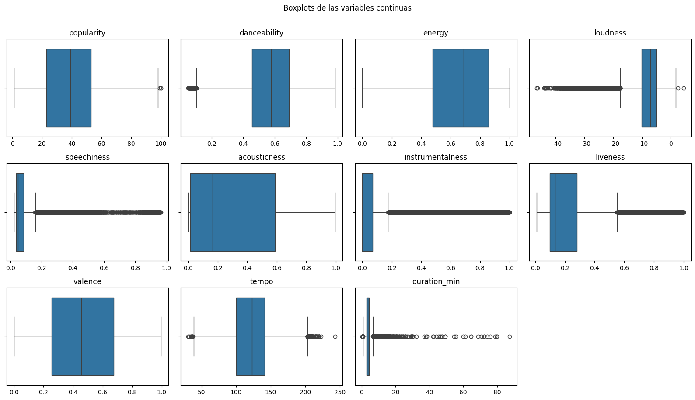
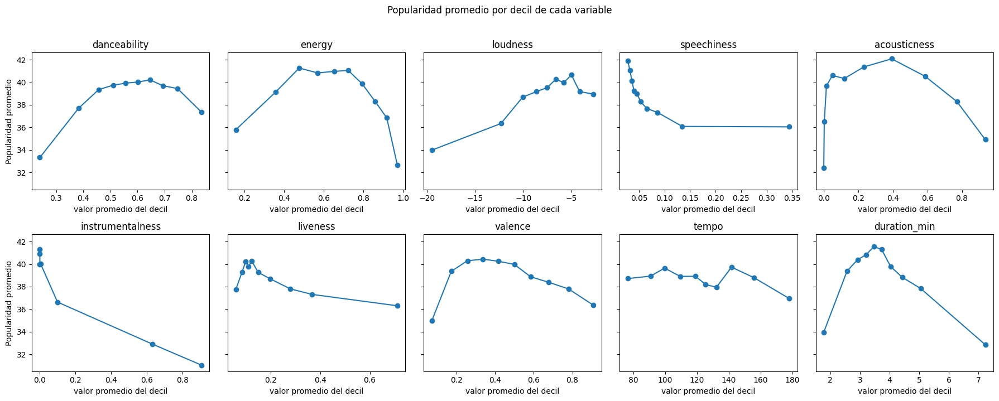

# Informe técnico EP1: inteligencia musical y predicción de popularidad de canciones

**Asignatura:** Machine Learning (MLY1101) - Evaluación Parcial N.° 1  
**Caso:** C - Spotify Tracks  
**Integrantes:** Moira Bittner, Lucas Fernandez y Julian Martinez  
**Notebook asociado:** `notebooks/EP1-ML.ipynb`

---

## 1. Descripción del problema de negocio

Planteamos el caso de un **sello discográfico o equipo de marketing musical** que tiene que decidir en qué canciones invertir su presupuesto de promoción. Hoy esa decisión se toma en gran parte por intuición, lo que puede llevar a gastar recursos en canciones con poco potencial. Además, el sello no puede promocionar todo su catálogo: solo una selección pequeña.

Queremos saber si es posible **estimar la popularidad de una canción a partir de sus características musicales y descriptivas**, para ordenar las canciones candidatas y priorizar las de mayor potencial. La variable objetivo es `popularity` (de 0 a 100). Es una variable numérica discreta (solo toma enteros), pero por su amplio rango (101 valores posibles) se trata como continua, por lo que el problema se aborda como **regresión supervisada**.

---

## 2. Objetivos del proyecto

**Objetivo general:** analizar las características musicales y descriptivas de las canciones para identificar patrones y variables útiles en la predicción de su popularidad, y dejar los datos preparados para el modelamiento.

**Objetivos específicos:**

1. Evaluar la calidad del dataset: valores nulos, duplicados, valores atípicos y registros anómalos.
2. Explorar la distribución de `popularity` y su relación con las características musicales, el género y el contenido explícito, comprobando si esas relaciones son lineales.
3. Preparar los datos para el modelamiento: limpieza, transformación, codificación, división y escalamiento.
4. Identificar posibles sesgos, riesgos éticos y aspectos de privacidad de los datos.
5. Definir métricas y criterios de salida que permitan decidir, en la etapa de modelado, si un modelo aporta valor al negocio.

---

## 3. Métricas y criterios de salida

### 3.1 Algoritmos considerados

Como la variable objetivo es numérica, los algoritmos candidatos son de **regresión**. La selección inicial considera un modelo lineal regularizado (**Ridge**), que es interpretable y controla la multicolinealidad (sección 5.6), y modelos de árboles (**Random Forest** y **Gradient Boosting**), que capturan las relaciones no lineales encontradas en el EDA (sección 5.5) y las interacciones entre el género y el audio.

### 3.2 KPIs y metas

Definimos como **canción de alto potencial** a la que tiene `popularity >= 50`, que corresponde al cuartil superior del dataset de modelamiento (26,4 % de las canciones).

| Nivel | KPI | Meta | Origen de la meta |
|---|---|---|---|
| Modelo | MAE: error promedio en puntos de popularidad | < 9,88 puntos | MAE de la regla "promedio del género" |
| Modelo | R² ajustado: variabilidad explicada, penalizada por el número de variables | > 0,431 | R² ajustado de la misma regla |
| Negocio | Precisión en el top 10 %: de las canciones con mayor popularidad predicha, % que realmente es de alto potencial | > 75,6 % | Precisión de la misma regla |
| Datos | Calidad del dataset preparado | 0 nulos, 0 duplicados y 0 registros de audio inválidos | Se cumple (sección 6.1) |

**¿Por qué comparar contra la "regla por género"?** Para fijar las metas calculamos dos referencias sin Machine Learning sobre el conjunto de prueba:

| Referencia | MAE | R² | R² ajustado | Precisión top 10 % |
|---|---:|---:|---:|---:|
| Predecir siempre el promedio de entrenamiento | 15,19 | 0,000 | 0,000 | 25,6 % |
| Predecir el promedio del género de cada canción | **9,88** | 0,435 | **0,431** | **75,6 %** |

En una versión anterior la meta del MAE era un error 20 % menor que predecir siempre el promedio (15,19 × 0,8 = 12,15). Esa meta no era exigente: la regla por género, que cualquier persona del sello podría calcular en una planilla, ya logra 9,88, un **35 % mejor** que el promedio. Lo mismo pasaba con el R² (meta inicial 0,35) y con la precisión (meta inicial 60 %). Por eso fijamos un criterio único y justificable: **un modelo solo aporta valor si supera a la regla por género en las tres métricas**.

La meta del MAE también tiene sentido para el negocio: en el dataset de modelamiento el primer cuartil de popularidad es 22 y el umbral de alto potencial es 50. Un error menor a 9,88 puntos es menos de la mitad de esa distancia ((50 − 22) / 2 = 14), por lo que el modelo podría distinguir con claridad una canción de baja popularidad de una de alto potencial.

### 3.3 R² frente a R² ajustado

El **R²** mide qué proporción de la variabilidad de `popularity` explica el modelo comparado con predecir siempre la media. Su problema es que **siempre sube (o se mantiene) al agregar variables**, aunque no aporten nada. Como el modelo usará **142 variables** (la mayoría columnas one-hot del género), un R² alto podría deberse solo a la cantidad de columnas. Por eso usamos el **R² ajustado**, que descuenta el número de predictores:

$$R^2_{aj} = 1 - (1 - R^2)\,\frac{n - 1}{n - p - 1}$$

donde $n$ es la cantidad de canciones evaluadas y $p$ la cantidad de variables. Una variable que no mejora el ajuste hace **bajar** el R² ajustado. Con $n = 16.047$ canciones de prueba y $p = 142$, el factor de penalización es 16.046 / 15.904 = 1,0089. La regla por género usa 113 columnas (114 géneros menos uno), así que el modelo, con 142, recibe una penalización mayor: para igualar el R² ajustado de 0,431 necesita un R² de al menos 0,436.

---

## 4. Fuente de datos, herramientas y especificación del conjunto

### 4.1 Fuente y herramientas

| Aspecto | Detalle |
|---|---|
| Archivo | `data/raw/Spotify_Tracks_Dataset.csv` |
| Origen | *Spotify Tracks Dataset*, publicado en Kaggle por Maharshi Pandya, con datos obtenidos desde la API de Spotify |
| Dimensiones | **114.000 registros y 21 columnas** |
| Variable objetivo | `popularity`: calculada por Spotify según la cantidad de reproducciones y qué tan recientes son |

**Herramientas:** trabajamos en **Google Colab**, porque ejecuta Python desde el navegador sin instalar nada y guarda el notebook en Google Drive, lo que nos permitió compartirlo y trabajar sobre la misma versión. Además, subimos el proyecto a un repositorio de **GitHub**, que guarda el historial de cambios de cada integrante y mantiene la estructura de carpetas para que cualquier persona pueda descargar y ejecutar la solución. Para el análisis usamos **Pandas** y **NumPy** (manipulación de datos), **Matplotlib** y **Seaborn** (gráficos) y **Scikit-learn** (división, escalamiento y regresión de apoyo para el VIF).

### 4.2 Diccionario de datos

Para cada variable indicamos su tipo en Python, su **clasificación estadística** (numérica continua, numérica discreta, categórica nominal o categórica ordinal) y su descripción.

| Variable | Tipo en Python | Clasificación estadística | Descripción |
|---|---|---|---|
| `Unnamed: 0` | int | Índice técnico, sin valor analítico | Numeración heredada del archivo original |
| `track_id` | texto | Categórica nominal (identificador) | Identificador de la canción en Spotify |
| `artists` | texto | Categórica nominal | Artista(s) de la canción, separados por `;` |
| `album_name` | texto | Categórica nominal | Nombre del álbum |
| `track_name` | texto | Categórica nominal | Nombre de la canción |
| `popularity` | int (0-100) | Numérica discreta | **Variable objetivo.** Popularidad calculada por Spotify según reproducciones y su recencia |
| `duration_ms` | int | Numérica continua | Duración en milisegundos. Se registra como entero, pero el tiempo es una magnitud continua |
| `explicit` | bool | Categórica nominal binaria | Indica si la canción tiene contenido explícito |
| `danceability` | float (0-1) | Numérica continua | Qué tan bailable es la canción |
| `energy` | float (0-1) | Numérica continua | Intensidad y actividad percibida |
| `key` | int (0-11) | Categórica nominal | Tonalidad (0 = Do, 1 = Do♯, ..., 11 = Si). Es un número, pero no tiene orden: las tonalidades son cíclicas y Si (11) no es "mayor" que Do (0) |
| `loudness` | float (dB) | Numérica continua | Volumen promedio en decibeles |
| `mode` | int (0/1) | Categórica nominal binaria | Modalidad: 1 = mayor, 0 = menor |
| `speechiness` | float (0-1) | Numérica continua | Índice de presencia de palabra hablada |
| `acousticness` | float (0-1) | Numérica continua | Confianza de que la canción sea acústica |
| `instrumentalness` | float (0-1) | Numérica continua | Probabilidad de que no tenga voz |
| `liveness` | float (0-1) | Numérica continua | Probabilidad de que sea una grabación en vivo |
| `valence` | float (0-1) | Numérica continua | Positividad musical (alegre frente a triste) |
| `tempo` | float (BPM) | Numérica continua | Tempo estimado en pulsos por minuto |
| `time_signature` | int | Categórica nominal | Compás estimado (3 a 7 corresponde a 3/4 a 7/4). Aunque los números tienen orden, un compás de 5/4 no es "más" que uno de 4/4 en un sentido útil, por lo que se trata como nominal |
| `track_genre` | texto | Categórica nominal | Género musical asignado (114 géneros) |

**Resumen:** 10 numéricas continuas, 1 numérica discreta (la objetivo), 9 categóricas nominales (2 binarias, 2 codificadas como números y 5 de texto) y 1 índice sin valor analítico.

**Variables ordinales:** el dataset no tiene variables ordinales en su forma original. La única que se construye en el proyecto es la categoría de **alto potencial** (`popularity >= 50`), que define un orden bajo/alto a partir de la variable objetivo y se usa solo para el KPI de negocio.

**Casos que requieren criterio:** `popularity` es discreta, pero se modela como continua; `duration_ms` es un entero, pero mide tiempo, que es continuo; `key` y `time_signature` son números, pero representan categorías, por lo que no se usan como cantidades.

---

## 5. Análisis exploratorio de los datos (EDA)

### 5.1 Calidad y limpieza de los datos

| Aspecto | Hallazgo | Acción |
|---|---|---|
| Valores nulos | 1 registro con nulos en `artists`, `album_name` y `track_name` (y `duration_ms = 0`) | Eliminado: es un registro defectuoso |
| Columna `Unnamed: 0` | Índice sin valor que ocultaba duplicados | Eliminada |
| Filas duplicadas | 0 al inicio, pero 450 al quitar `Unnamed: 0` | Eliminadas |
| `track_id` repetidos | 24.259 repeticiones: la misma canción en varios géneros | Una fila por canción para modelar (sección 5.7) |
| Audio no medible | 163 registros con `tempo = 0` o `time_signature = 0` (138 del género `sleep`, que no tiene pulso musical) | Eliminados para modelar |
| Valores poco frecuentes pero posibles | 973 con `time_signature = 1` y 90 con `loudness` > 0 dB | Mantenidos |
| Popularidad 0 | 16.020 canciones (14,05 %) | Excluidas del dataset de modelamiento (sección 5.2) |
| Atípicos | Revisados con IQR y puntaje Z en todas las variables continuas (sección 5.3) | Mantenidos; logaritmo en la duración |
| Formatos | `explicit` booleana; `duration_ms` en una unidad poco intuitiva | `explicit` a 0/1; duración en minutos y luego en logaritmo |

### 5.2 Canciones con popularidad 0

Las 16.020 canciones con popularidad 0 no se distribuyen al azar:

- Entre las canciones cuyo artista y nombre se repiten (por ejemplo, la misma canción en un álbum y en un recopilatorio), el **27,0 %** tiene popularidad 0, frente al **4,3 %** de las que no se repiten.
- **19 géneros** tienen 30 % o más de ceros. Por ejemplo, `iranian`, `romance` y `latin`, que aparecen entre los géneros menos populares, tienen cerca del 60 % de sus canciones con popularidad 0.

Un 0 no significa necesariamente que la canción no se escuche: puede ser una canción nueva que todavía no acumula reproducciones o una versión duplicada cuyas reproducciones se registran en otra versión. Lo tratamos como un **problema de medición**, no como un sesgo: se mantienen en el dataset limpio general, pero **se excluyen del dataset de modelamiento**, porque enseñarle al modelo que esas canciones tienen popularidad 0 sería enseñarle un valor que no corresponde a su popularidad real. La consecuencia es que el modelo **no servirá para canciones recién lanzadas sin historial**.

### 5.3 Valores atípicos

Revisamos la variable objetivo y las 10 variables continuas con dos métodos, sobre las canciones con audio válido y popularidad mayor a 0:

- **IQR:** valores bajo $Q_1 - 1,5 \cdot IQR$ o sobre $Q_3 + 1,5 \cdot IQR$.
- **Puntaje Z:** valores a más de 3 desviaciones estándar de la media ($|z| > 3$). Supone una distribución aproximadamente simétrica, por eso se compara con el IQR.

También calculamos la **asimetría**: valores mayores a 1 o menores a −1 indican una distribución muy asimétrica, donde el IQR marca como atípicos valores que en realidad son la cola normal de la variable.

| Variable | Atípicos IQR | Atípicos Z | Asimetría | Decisión |
|---|---:|---:|---:|---|
| `popularity` (objetivo) | 3 (0,00 %) | 18 (0,02 %) | 0,06 | **Mantener.** Casi no tiene atípicos y es simétrica; los valores cercanos a 100 son canciones reales muy populares |
| `danceability` | 443 (0,45 %) | 1 | −0,36 | Mantener |
| `energy`, `acousticness`, `valence` | 0 | 0 | −0,59 / 0,73 / 0,14 | Mantener |
| `tempo` | 267 (0,27 %) | 27 | 0,29 | Mantener |
| `loudness` | 4.983 (5,09 %) | 2.121 | −1,97 | Mantener: canciones suaves o ambientales reales, con un rango en dB válido |
| `speechiness` | 11.413 (11,67 %) | 1.776 | 4,58 | Mantener: los valores altos son pistas habladas o rap, dentro del rango 0-1 |
| `liveness` | 7.641 (7,81 %) | 3.159 | 2,06 | Mantener: los valores altos son grabaciones en vivo |
| `instrumentalness` | 21.528 (22,01 %) | 0 | 1,65 | Mantener: más de la mitad de las canciones vale ~0 (con voz), así que el IQR es casi 0 y cualquier canción instrumental queda "fuera". Es un efecto del método, no un error |
| `duration_min` | 4.629 (4,73 %) | 780 | **11,34** | **Transformar con logaritmo** |



**Conclusión:** no eliminamos canciones por ser atípicas, porque todos los valores son posibles en la escala de cada variable y representan tipos reales de canciones. La única transformación necesaria es el **logaritmo de la duración**: su asimetría baja de 11,34 a −0,34, y una canción de 87 minutos pasa de estar a más de 40 desviaciones estándar de la media a estar a unas 8. Sin esta transformación, al escalar, unas pocas canciones muy largas dominarían la media y la desviación estándar.

### 5.4 Estadística descriptiva y análisis univariado

- **Popularidad (dataset completo):** media 33,24 y mediana 35; la mitad central está entre 17 y 50. En el histograma destaca la barra de valores cercanos a 0, que llevó al análisis de la sección 5.2. **En el dataset de modelamiento** (sin ceros), la media es 37,06, la mediana 37 y la desviación estándar 18,16: la distribución queda casi simétrica.


- **Variables musicales:** `danceability` (media 0,57) y `energy` (0,64) se concentran en niveles intermedios y altos; `valence` está cerca del centro (0,47); `tempo` promedia 122 BPM. `speechiness`, `instrumentalness` y `liveness` concentran la mayoría de sus valores cerca de 0, con colas largas hacia la derecha.
- **Balance de géneros:** hay exactamente 1.000 canciones por cada uno de los 114 géneros, lo que indica un muestreo fijo por género (sección 7).

### 5.5 Análisis bivariado y correlaciones

- **Correlaciones con la popularidad:** todas las características musicales tienen correlaciones de Pearson bajas con `popularity`. En el dataset completo la más alta en valor absoluto es `instrumentalness` (−0,10); en el de modelamiento, −0,18.
- **Género:** es la variable con diferencias más claras. Los géneros con mayor popularidad media son `pop-film` (59,28), `k-pop` (56,90) y `chill` (53,65).
- **Contenido explícito:** las canciones explícitas tienen una popularidad media de 36,45, frente a 32,94 de las no explícitas. Esto no implica causalidad: puede deberse al género o al tipo de audiencia.


#### Comprobación de linealidad

La correlación de Pearson **solo mide relaciones en línea recta**: un valor cercano a cero no descarta una relación curva. Para comprobar el supuesto de linealidad hicimos tres revisiones:

1. **Pearson frente a Spearman:** Spearman mide relaciones que siempre suben o siempre bajan, aunque no sea en línea recta. Si es claramente distinta de Pearson, la relación no es lineal.
2. **Ajuste lineal frente a cuadrático:** comparamos el R² de una recta con el de una curva de grado 2 para cada variable.
3. **Popularidad promedio por decil** de cada variable: si la relación fuera lineal, los puntos formarían una recta.

| Variable | Pearson | Spearman | R² lineal | R² cuadrático |
|---|---:|---:|---:|---:|
| `acousticness` | −0,009 | +0,048 | 0,0001 | 0,0151 |
| `energy` | −0,034 | −0,067 | 0,0011 | 0,0158 |
| `danceability` | 0,062 | 0,053 | 0,0038 | 0,0122 |
| `valence` | −0,013 | −0,014 | 0,0002 | 0,0067 |
| `loudness` | 0,072 | 0,067 | 0,0052 | 0,0065 |
| `instrumentalness` | −0,182 | −0,170 | 0,0332 | 0,0342 |
| `speechiness` | −0,090 | −0,104 | 0,0082 | 0,0082 |



**Resultados:**

- Todas las relaciones individuales son débiles: el R² más alto es el de `instrumentalness` (cerca de 0,03).
- **Sí hay relaciones no lineales.** `acousticness` tiene una correlación de Pearson prácticamente 0, pero Spearman tiene el signo contrario y la curva explica cerca de un 1,5 % de la variabilidad, frente al 0,01 % de la recta: la popularidad es más alta en los valores intermedios y baja en ambos extremos, por lo que en una recta los efectos se cancelan. `energy`, `danceability` y `valence` muestran el mismo patrón.
- En los deciles, varias relaciones tienen forma de **"U invertida"**: `danceability`, `energy`, `acousticness`, `valence` y la duración alcanzan su mayor popularidad en valores intermedios (las canciones de unos 3,5 minutos son las más populares). `instrumentalness` y `loudness` se parecen más a una recta.

**Conclusión:** el supuesto de linealidad no se cumple para todas las variables, por lo que la matriz de correlación **subestima** algunas relaciones. Para el modelado esto implica probar modelos que capturen relaciones no lineales (árboles, Random Forest o Gradient Boosting) y, si se usa un modelo lineal, agregar términos cuadráticos para `energy`, `acousticness`, `danceability` y `valence`.

### 5.6 Multicolinealidad entre variables musicales

Cuando dos o más predictoras están muy correlacionadas (**multicolinealidad**), un modelo lineal no puede separar bien el efecto de cada una: los coeficientes se vuelven inestables y difíciles de interpretar, aunque la predicción total no necesariamente empeore. Revisamos los pares con |r| ≥ 0,5 y calculamos el **VIF** (*Variance Inflation Factor*) de cada variable continua: un VIF mayor a 5 indica multicolinealidad preocupante y mayor a 10, grave.

| Par de variables | Correlación |
|---|---:|
| `energy` - `loudness` | 0,76 |
| `energy` - `acousticness` | −0,73 |
| `loudness` - `acousticness` | −0,58 |

| Variable | VIF |
|---|---:|
| `energy` | 4,24 |
| `loudness` | 3,25 |
| `acousticness` | 2,38 |
| `valence` | 1,54 |
| `danceability`, `instrumentalness` | 1,46 |
| `liveness`, `speechiness`, `tempo`, duración | 1,05 a 1,15 |

**¿Por qué están relacionadas?** Según la documentación de la API de Spotify, `energy` es una medida perceptual que considera el rango dinámico, el **volumen percibido**, el timbre y la velocidad de los ataques. Como el volumen es uno de sus componentes, la correlación con `loudness` es en buena parte estructural. Una canción acústica, por su parte, usa instrumentos sin amplificación y suele sonar más suave y menos intensa, por eso `acousticness` se opone a las dos.

**Decisión:** por ahora **no eliminamos ninguna variable**, porque:

1. Ningún VIF supera el umbral de 5: la multicolinealidad es **moderada**.
2. `energy` y `acousticness` tienen relaciones curvas con la popularidad que la otra variable no reemplaza por completo (sección 5.5).
3. Los modelos de árboles no pierden capacidad de predicción por la multicolinealidad.

En el modelado, si se usa un modelo lineal, se probará eliminar `energy` (la más redundante) o usar **Ridge**, que estabiliza los coeficientes. Al interpretar la importancia de las variables habrá que considerar que el efecto de la intensidad se reparte entre las tres.

### 5.7 Una misma canción clasificada en varios géneros

**12.640 canciones (15,8 %)** aparecen en 2 o más géneros, hasta 9 para una misma canción. Entre las copias, **las características musicales son idénticas** (0 % de cambios): es exactamente la misma pista, y solo cambia la etiqueta de género y, en el 4,9 % de los casos, la popularidad. Las combinaciones más frecuentes son géneros casi sinónimos: `dub` + `dubstep` (600 canciones), `singer-songwriter` + `songwriter` (429), `punk` + `punk-rock` (273) o `pop` + `pop-film` (180).

Esto muestra que el género **no es una propiedad de la canción, sino una etiqueta de catálogo**, y que varias categorías se solapan. Para modelar conservamos una fila por canción, elegida al azar con semilla fija, para que la misma canción no quede en entrenamiento y en prueba a la vez (fuga de información). No usamos la primera aparición porque el archivo está ordenado alfabéticamente por género. El costo es que el género que queda es uno de varios posibles (sección 7).

---

## 6. Preparación de los datos

### 6.1 Pasos de preparación

| Paso | Acción | Filas | Justificación |
|---|---|---:|---|
| 1 | Eliminar `Unnamed: 0`, el registro con nulos y las filas duplicadas | 113.549 | Registros sin valor o repetidos. Se exporta como `data/processed/Spotify_Tracks_Dataset_Limpio.csv` |
| 2 | Convertir `explicit` a 0/1 y crear `duration_min` | 113.549 | Formato numérico y una unidad más fácil de interpretar |
| 3 | Eliminar audio no medible (`tempo` o `time_signature` = 0) | 113.386 | Sus características no describen una canción real |
| 4 | Excluir canciones con popularidad 0 | 97.547 | Falta de medición (sección 5.2) |
| 5 | Una fila por `track_id`, elegida al azar con semilla 42 | **80.235** | Evitar la fuga de información (sección 5.7) |
| 6 | Seleccionar variables: excluir identificadores, texto y `duration_ms` | 80.235 | Ver sección 6.3 |
| 7 | Reemplazar `duration_min` por `duration_log` | 80.235 | Asimetría extrema (sección 5.3) |
| 8 | One-hot encoding de `track_genre`, `key` y `time_signature` | 80.235 | Son categorías sin orden; quedan 142 variables |
| 9 | División 80/20 en entrenamiento y prueba (semilla 42) | 64.188 / 16.047 | Evaluar el modelo con canciones que no vio |
| 10 | `StandardScaler` en las 10 variables continuas | 64.188 / 16.047 | Escalas muy distintas (sección 6.4) |

El dataset de modelamiento tiene 0 nulos, 0 `track_id` repetidos, 0 registros de audio inválido y los 114 géneros representados: **se cumple el KPI de calidad de datos**.

### 6.2 Generación de nuevas variables y codificación

- **`explicit`** pasa de booleana a 0/1. `mode` ya está en 0/1.
- **`duration_min`** = `duration_ms` / 60.000, más fácil de interpretar. Para el modelo se reemplaza por **`duration_log`** = log(`duration_min`), que conserva el orden de las canciones pero acerca la distribución a una forma simétrica.
- **One-hot encoding** de `track_genre` (114 categorías), `key` (12) y `time_signature` (4): crea una columna 0/1 por categoría. No usamos códigos numéricos porque un modelo lineal supondría que la tonalidad 11 tiene un efecto 11 veces mayor que la 1, lo que no tiene sentido para variables nominales.

### 6.3 Selección de variables y análisis de dimensionalidad

**Variables excluidas:** `track_id` y `track_name` son únicos por canción y el modelo los memorizaría sin aprender nada aplicable a canciones nuevas; `album_name` y `artists` tienen miles de valores distintos (alta cardinalidad), y además `artists` contiene nombres de personas; `duration_ms` es redundante con la duración transformada. Aunque el artista explicaría mucha popularidad, el sello quiere evaluar **la canción**, y un artista nuevo no tendría historial.

**Variables incluidas (15 originales):** 10 numéricas continuas (`danceability`, `energy`, `loudness`, `speechiness`, `acousticness`, `instrumentalness`, `liveness`, `valence`, `tempo`, `duration_log`), 2 binarias (`explicit`, `mode`) y 3 categóricas (`key`, `time_signature`, `track_genre`).

**Dimensionalidad:** después de la codificación quedan **142 columnas** (12 numéricas y binarias + 114 de género + 12 de tonalidad + 4 de compás). Con 64.188 canciones de entrenamiento hay más de 450 canciones por columna, por lo que no hay riesgo de tener más variables que observaciones. No aplicamos reducción de dimensionalidad (por ejemplo, PCA) porque la mayoría de las columnas son one-hot del género, la variable más informativa, y combinarlas haría perder su interpretación. La multicolinealidad de las variables continuas es moderada (sección 5.6), así que tampoco obliga a combinarlas. El R² ajustado se usa justamente para controlar que el número de columnas no infle el resultado (sección 3.3).

### 6.4 Escalamiento de variables numéricas

Aplicamos **StandardScaler** (media 0 y desviación estándar 1) a las 10 variables continuas, porque tienen escalas muy distintas (por ejemplo, `tempo` en BPM y `danceability` entre 0 y 1). Las variables binarias y one-hot no se escalan, porque ya están en la misma escala 0/1.

**El escalamiento se hace después de dividir, y se aplica a los dos conjuntos con el mismo escalador:**

1. `fit_transform` sobre **entrenamiento**: el escalador calcula la media y la desviación estándar **solo con esos datos** y los transforma.
2. `transform` sobre **prueba**: el conjunto de prueba **sí se escala**, pero con la media y la desviación estándar de entrenamiento, no con las suyas propias.

Si escaláramos antes de dividir, la media y la desviación estándar incluirían información de las canciones de prueba, y el modelo sería evaluado con datos que de alguna forma "ya conoció" (fuga de información). Al hacerlo después, el conjunto de prueba se comporta como canciones nuevas que llegan al sello.

Lo importante es que **todo dato que entre al modelo debe estar escalado con los mismos parámetros**. Si el modelo aprende con valores escalados y después recibe valores sin escalar (por ejemplo, `tempo = 120` en vez de un valor cercano a 0), los pesos aprendidos se multiplicarían por números de otra magnitud y la predicción quedaría distorsionada. Por eso el escalador se **guarda** en `models/escalador_standard.joblib`, para aplicar exactamente la misma transformación a cualquier canción nueva antes de predecir.

**Verificación:** después de escalar, ambos conjuntos quedan en la misma escala.

| Conjunto | Medias de las 10 variables | Desviaciones estándar |
|---|---|---|
| Entrenamiento | 0,00 | 1,00 |
| Prueba | Entre −0,02 y 0,01 | Entre 0,98 y 1,02 |

Los valores de prueba no son exactamente 0 y 1 porque se escalaron con los parámetros de entrenamiento, que es lo esperado.

---

## 7. Evaluación de sesgos, ética y privacidad

### 7.1 Sesgos identificados

Un sesgo es un error **sistemático** que hace que el modelo favorezca o perjudique de forma consistente a un grupo de canciones o que distorsione lo que aprende. Distinguimos los sesgos de las limitaciones de los datos que no lo son.

| Sesgo | Qué ocurre en este dataset | Efecto en el modelo | Cómo se controla |
|---|---|---|---|
| **De retroalimentación (por el género como predictor)** | El género es la variable con diferencias más claras: la regla "promedio del género" ya logra un MAE de 9,88 | El modelo puede aprender "género popular = canción popular". Si el sello promociona solo lo que el modelo predice alto, los géneros que hoy son menos populares recibirán menos promoción y seguirán siéndolo: el modelo **reproduce y refuerza** la situación actual | En el modelado se medirá el error **por género** y cuánto depende el modelo del género frente al audio. El modelo debe ser apoyo, no decisión automática |
| **De etiquetado (género ambiguo)** | El 15,8 % de las canciones aparece en 2 a 9 géneros con exactamente el mismo audio, por ejemplo `dub` + `dubstep` o `punk` + `punk-rock`. Es contradictorio: la misma canción no puede pertenecer a categorías distintas por sus propiedades | Al dejar una fila por canción, el género se elige al azar entre los posibles: la misma canción pudo quedar como "pop" o como "pop-film". Esto agrega ruido y mezcla el efecto de géneros parecidos | Se documenta como limitación. Una mejora futura sería agrupar géneros sinónimos o usar una codificación que admita varios géneros por canción |
| **De variable omitida** | La popularidad depende de factores que no están en el dataset: fama del artista, promoción, presencia en playlists y fecha de lanzamiento | El modelo puede atribuir al género o al sonido efectos que en realidad son del artista o de la promoción, y subestimará a los artistas ya famosos | Se interpreta la importancia de las variables como asociación, no como causa, y se recomienda agregar esas variables en el futuro |

**Lo que no consideramos sesgo:**

- **Canciones con popularidad 0.** Es un **problema de medición** (canciones nuevas o versiones duplicadas sin reproducciones registradas), no un sesgo. Por eso se excluyeron del modelamiento (sección 5.2), con la limitación de que el modelo no sirve para canciones sin historial.
- **Representación igualitaria de los géneros.** Que haya exactamente 1.000 canciones por género **no representa** la proporción real de géneros en Spotify, por lo que el modelo no debe usarse para concluir qué tan popular es un género en el catálogo completo. Pero, desde el punto de vista del modelo, es **positivo**: aprende con la misma cantidad de ejemplos de cada género y no queda dominado por los mayoritarios. Después de la preparación se mantienen los 114 géneros, aunque ya no con la misma cantidad cada uno.
- **La popularidad no es calidad.** Es una **limitación de la variable objetivo**, no un sesgo: el modelo predecirá popularidad, que depende de la promoción y las tendencias, y no la calidad musical.

### 7.2 Ética

- Si un sello promociona solo las canciones con mayor popularidad predicha, esas canciones se vuelven aún más populares y los artistas emergentes o los géneros minoritarios reciben menos oportunidades. Por eso el modelo debe usarse como **apoyo a la decisión** y no como decisión automática.
- Los resultados deben interpretarse como estimaciones basadas en los datos disponibles y no como una medida absoluta del éxito o la calidad de una canción.

### 7.3 Privacidad y uso de la fuente

- El dataset **no incluye datos personales de usuarios** de Spotify, por lo que el riesgo de privacidad es bajo. Sin embargo, `artists` contiene nombres de personas, por lo que no se usa como variable del modelo.
- En Chile, la **Ley N.° 21.719** de protección de datos personales (publicada en diciembre de 2024, con entrada en vigencia prevista para el 1 de diciembre de 2026 y un proyecto de postergación a diciembre de 2027 en trámite) establece el principio de usar solo los datos necesarios para la finalidad definida. Si el sello agregara datos de artistas o de oyentes para mejorar el modelo, tendría que cumplirla.
- Los términos para desarrolladores de Spotify restringen el uso de su contenido para entrenar modelos de Machine Learning, por lo que este proyecto tiene fines exclusivamente académicos.

---

## 8. Metodología utilizada (CRISP-DM)

Usamos **CRISP-DM** porque parte desde el problema de negocio y permite volver a etapas anteriores cuando aparecen problemas en los datos.

| Fase | Qué hicimos | Estado |
|---|---|---|
| 1. Comprensión del negocio | Problema, objetivos, algoritmos candidatos y metas comparadas con una regla simple | Desarrollada |
| 2. Comprensión de los datos | Diccionario y clasificación de variables, calidad, atípicos, linealidad y multicolinealidad | Desarrollada |
| 3. Preparación de los datos | Limpieza, transformación, codificación, división y escalamiento | Desarrollada |
| 4. Modelado | Entrenar los modelos de regresión | EP2 |
| 5. Evaluación | Medir los KPIs | EP2 |
| 6. Despliegue | Uso de las predicciones por el negocio | EP2 |

Durante el proyecto volvimos a fases anteriores cuando los datos lo indicaron: las metas de los KPIs (fase 1) se ajustaron al calcular la regla por género en la fase 3.

---

## 9. Conclusiones

El dataset tiene suficientes registros y pocos nulos, pero presenta problemas de calidad que solo aparecieron al revisarlo en detalle: duplicados ocultos por la columna índice, audio no medible, un 14,05 % de popularidad 0 que refleja falta de medición y canciones repetidas en varios géneros con exactamente el mismo audio.

La popularidad del dataset de modelamiento tiene una media de **37,06** y una mediana de **37**, sin valores atípicos. Las características musicales tienen correlaciones bajas con `popularity`, pero la comprobación de linealidad mostró que varias relaciones son **curvas** ("U invertida"), por lo que la matriz de correlación las subestima. Entre las predictoras hay multicolinealidad moderada (`energy`, `loudness` y `acousticness`, VIF máximo 4,24), que no obliga a eliminar variables pero orienta el uso de Ridge y de modelos de árboles.

El género es la variable con diferencias más claras: una regla basada solo en el promedio del género logra un MAE de 9,88, un R² ajustado de 0,431 y una precisión de 75,6 % en el top 10 %, por lo que las metas del modelo se fijaron en **superar esa regla**.

Finalmente, el dataset limpio queda con **113.549 registros** y el dataset para modelamiento con **80.235 canciones únicas** y **142 variables**, con la duración transformada con logaritmo, codificado, dividido y escalado con un escalador guardado para aplicarlo a canciones nuevas. En la siguiente etapa se entrenarán modelos de regresión, incluidos modelos no lineales, y se evaluarán con los KPIs definidos.

---

## 10. Reproducibilidad

### Estructura del proyecto

```text
spotify-popularidad-ml/
├── README.md
├── EP1-ML-INFORME.md
├── EP2-ML-INFORME.md
├── requirements.txt
├── data/
│   ├── raw/Spotify_Tracks_Dataset.csv                 # dataset original
│   └── processed/Spotify_Tracks_Dataset_Limpio.csv    # generado por el notebook EP1
├── notebooks/
│   ├── EP1-ML.ipynb
│   └── EP2_Spotify_Moira_Lucas_Julian.ipynb
├── images/                                            # gráficos generados por los notebooks
└── models/
    ├── escalador_standard.joblib                      # EP1: escalador para canciones nuevas
    ├── modelo_final.joblib                            # EP2
    └── kmeans_perfiles.joblib                         # EP2
```

### Cómo ejecutar

1. Instalar las librerías con `pip install -r requirements.txt` (en Google Colab ya vienen instaladas).
2. Abrir `notebooks/EP1-ML.ipynb` y ejecutar todas las celdas en orden.
3. El notebook lee los datos desde `data/raw/`, guarda el dataset limpio en `data/processed/`, los gráficos en `images/` y el escalador en `models/`. Como usa la semilla 42, siempre entrega los mismos resultados.

**Referencias:**

- Pandya, M. *Spotify Tracks Dataset*. Kaggle: https://www.kaggle.com/datasets/maharshipandya/-spotify-tracks-dataset
- Spotify for Developers. *Get Track's Audio Features*: https://developer.spotify.com/documentation/web-api/reference/get-audio-features
- Spotify Developer Terms: https://developer.spotify.com/terms
- Ley N.° 21.719, que regula la protección y el tratamiento de los datos personales. Diario Oficial de Chile, 2024.
