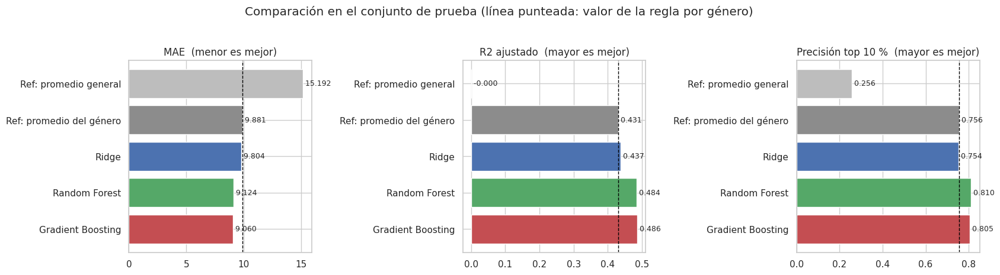
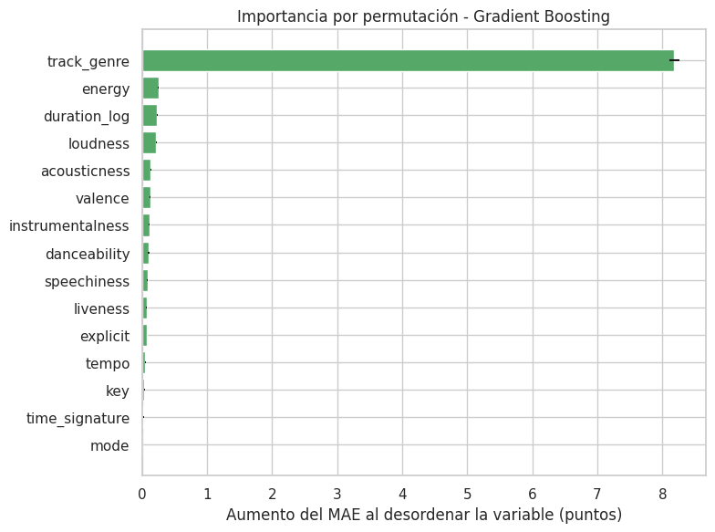
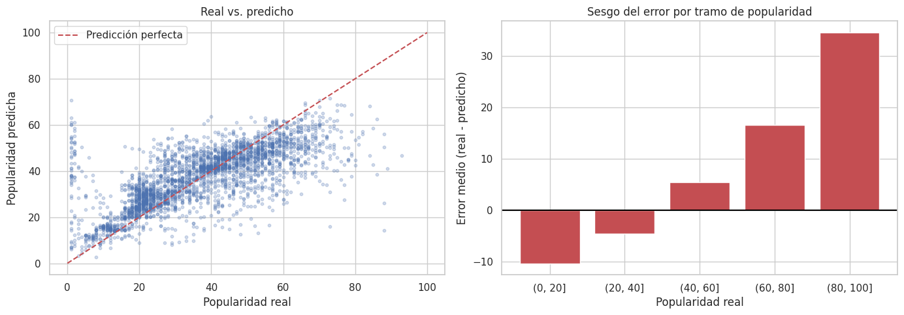
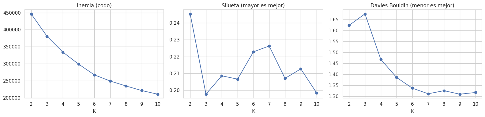
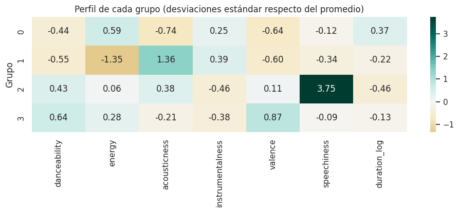
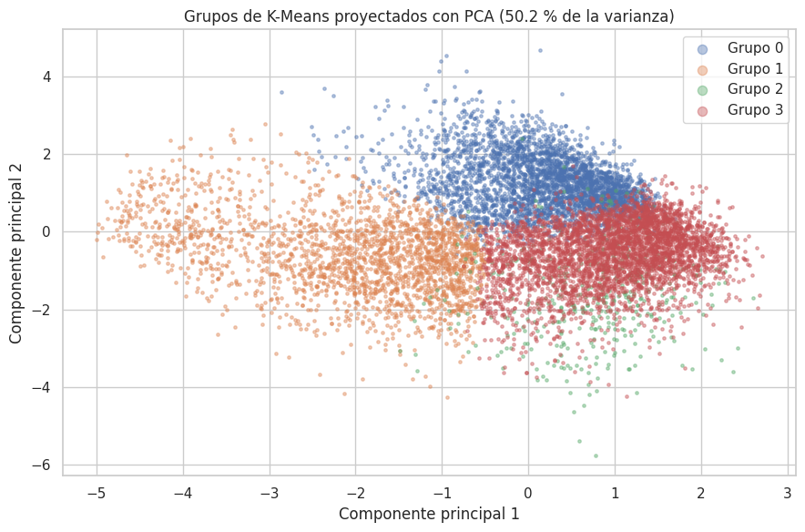
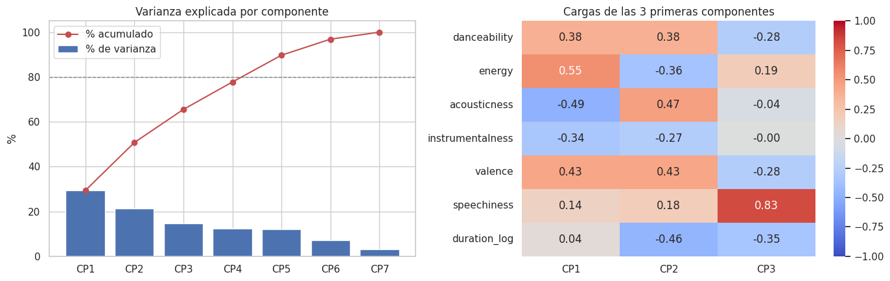
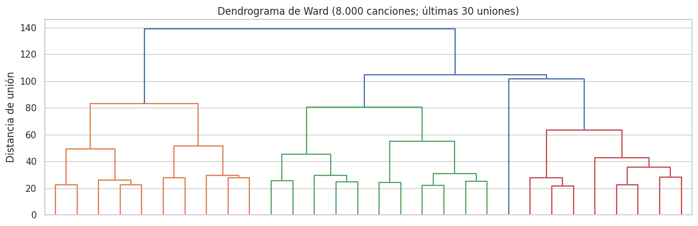

# Informe técnico EP2: predicción de popularidad y perfiles de sonido en Spotify

**Asignatura:** Machine Learning (MLY1101) - Evaluación Parcial N.° 2  
**Caso:** C - Spotify Tracks  
**Integrantes:** Moira Bittner, Lucas Fernandez y Julian Martinez  
**Notebook asociado:** `notebooks/EP2_Spotify_Moira_Lucas_Julian.ipynb`  
**Antecedente:** EP1 corregida del mismo caso (`notebooks/EP1-ML.ipynb`): comprensión de los datos, EDA, limpieza, atípicos, linealidad y multicolinealidad.

---

## 1. Problema de negocio

Planteamos el caso de un **sello discográfico o equipo de marketing musical** que debe decidir en qué canciones invertir su presupuesto de promoción. Hoy esa decisión se toma en gran parte por intuición, y el sello solo puede promocionar una selección pequeña de su catálogo.

Queremos **estimar la popularidad de una canción** (`popularity`, de 0 a 100) a partir de sus características musicales y su género, para ordenar las canciones candidatas y priorizar las de mayor potencial para una revisión humana. La popularidad es un número entero, pero por su amplio rango la tratamos como variable numérica, por lo que el problema principal es de **regresión supervisada**.

Como complemento, usamos **aprendizaje no supervisado** para responder otra pregunta: *¿qué perfiles de sonido existen en el catálogo?* Esto sirve para organizar playlists y campañas por tipo de sonido sin depender de las etiquetas de género, que en la EP1 vimos que se solapan. Para eso usamos **K-Means** (perfiles de sonido), **PCA** (cuántas dimensiones tiene el sonido y qué representa cada una) y un **agrupamiento jerárquico de Ward** (para validar los perfiles con un segundo algoritmo). Ninguno usa `popularity` para formar los grupos.

## 2. Objetivos

**Objetivo general:** construir, comparar y seleccionar un modelo de Machine Learning que estime la popularidad de una canción mejor que una regla simple, y describir el catálogo mediante perfiles de sonido.

**Objetivos específicos:**

1. Implementar, ajustar y comparar tres modelos supervisados de regresión (Ridge, Random Forest y Gradient Boosting) con métricas adecuadas al problema.
2. Justificar las variables, transformaciones e hiperparámetros de cada modelo según cómo funciona el algoritmo.
3. Probar distintos conjuntos de variables y datos para identificar qué decisiones cambian el error de forma relevante.
4. Interpretar qué variables usa el modelo, en qué casos se equivoca y si su error cambia según el género.
5. Aplicar aprendizaje no supervisado (K-Means, PCA y agrupamiento jerárquico) para identificar perfiles de sonido, validarlos y evaluar su utilidad para el negocio.
6. Seleccionar el modelo final y traducir los resultados en recomendaciones para el sello.

### 2.1 Criterios de salida

El criterio común, definido en la EP1 corregida, es que **un modelo solo aporta valor si supera a una regla que el sello podría calcular sin Machine Learning**: asignar a cada canción la popularidad promedio de su género (aprendida solo con el entrenamiento).

| Nivel | Métrica | Meta | Origen de la meta |
|---|---|---|---|
| Modelo | MAE (error promedio en puntos) | < 9,88 | MAE de la regla "promedio del género" |
| Negocio | Precisión en el top 10 % | > 75,6 % | Precisión de la misma regla |
| Modelo (secundario) | R² ajustado | > 0,431 | R² ajustado de la misma regla (ver sección 7.1) |
| Datos | Calidad del dataset | 0 nulos, 0 duplicados, 0 audios inválidos | Se cumple (sección 5) |

Se considera **canción de alto potencial** a la que tiene `popularity >= 50` (cuartil superior del dataset de modelamiento). Es un criterio operativo de este proyecto, no una definición oficial de Spotify.

---

## 3. Fuente de datos, dimensiones y diccionario de variables

| Aspecto | Detalle |
|---|---|
| Archivo | `data/raw/Spotify_Tracks_Dataset.csv` |
| Origen | *Spotify Tracks Dataset*, Kaggle (Maharshi Pandya), con atributos obtenidos desde la API de Spotify |
| Tamaño original | 114.000 registros y 21 columnas |
| Dataset de modelamiento | **80.235 canciones únicas** y 15 variables predictoras (142 columnas después de la codificación one-hot) |
| Variable objetivo | `popularity` (0-100), calculada por Spotify según la cantidad de reproducciones y qué tan recientes son |

| Variable | Tipo en Python | Clasificación estadística | Descripción y uso |
|---|---|---|---|
| `Unnamed: 0` | int | Índice técnico, sin valor analítico | Numeración exportada; se elimina |
| `track_id` | texto | Categórica nominal (identificador) | Identifica la canción; se usa para dejar una fila por canción y se excluye del modelo |
| `artists` | texto | Categórica nominal | Artista(s); se excluye por alta cardinalidad y para evaluar la canción sin el historial del artista |
| `album_name` | texto | Categórica nominal | Álbum; se excluye por alta cardinalidad |
| `track_name` | texto | Categórica nominal | Nombre de la canción; se excluye para no memorizar identificadores |
| `popularity` | int (0-100) | Numérica discreta | **Variable objetivo (`y`).** Se trata como continua por su amplio rango |
| `duration_ms` | int | Numérica continua | Duración en milisegundos; en los modelos se reemplaza por `duration_log` |
| `explicit` | bool | Categórica nominal binaria | Contenido explícito (0/1) |
| `danceability` | float (0-1) | Numérica continua | Qué tan bailable es la canción |
| `energy` | float (0-1) | Numérica continua | Intensidad y actividad percibida |
| `key` | int (0-11) | Categórica nominal codificada como número | Tonalidad; el código no es una cantidad ordenable (11 = Si no es "más" que 0 = Do) |
| `loudness` | float (dB) | Numérica continua | Volumen promedio en decibeles |
| `mode` | int (0/1) | Categórica nominal binaria | Modalidad mayor (1) o menor (0) |
| `speechiness` | float (0-1) | Numérica continua | Índice de presencia de palabra hablada (no es un porcentaje de voz) |
| `acousticness` | float (0-1) | Numérica continua | Confianza de que la canción sea acústica |
| `instrumentalness` | float (0-1) | Numérica continua | Probabilidad de que no tenga voz |
| `liveness` | float (0-1) | Numérica continua | Probabilidad de que sea una grabación en vivo |
| `valence` | float (0-1) | Numérica continua | Positividad musical percibida |
| `tempo` | float (BPM) | Numérica continua | Tempo estimado en pulsos por minuto |
| `time_signature` | int | Categórica nominal codificada como número | Compás estimado; se usa como categoría |
| `track_genre` | texto | Categórica nominal (114 categorías) | Género de catálogo; predictor supervisado y descriptor de los grupos de K-Means |

**Resumen:** 10 numéricas continuas, 1 numérica discreta (la objetivo), 9 categóricas nominales (2 binarias, 2 codificadas como números y 5 de texto) y 1 índice sin valor analítico. No hay variables ordinales originales. `duration_log` es una **variable derivada**, no una columna del CSV.

---

## 4. Hallazgos del EDA que guían el modelamiento

El EDA completo está en la EP1. Estos son los hallazgos que **determinaron las decisiones** de la EP2:

| Hallazgo de la EP1 | Decisión en la EP2 |
|---|---|
| Correlaciones lineales bajas entre el audio y la popularidad (máximo \|r\| = 0,18) | No descartar variables por su correlación; probar modelos no lineales |
| Relaciones curvas ("U invertida") en `energy`, `acousticness`, `danceability`, `valence` y la duración | Usar modelos de árboles y probar términos cuadráticos en Ridge |
| El género es la variable con más diferencias de popularidad | Incluir `track_genre` y usar la regla por género como referencia |
| Multicolinealidad moderada entre `energy`, `loudness` y `acousticness` (VIF máximo 4,24) | Usar Ridge en vez de regresión lineal simple; probar quitar `energy`; excluir `loudness` de K-Means |
| Duración muy asimétrica (asimetría 11,34) | Usar el logaritmo de la duración (asimetría −0,34) |
| La popularidad 0 refleja sobre todo falta de medición | Excluirla y comprobar el efecto con una validación interna |
| La misma canción aparece en varios géneros con el mismo audio | Una fila por canción, para que no quede en entrenamiento y prueba a la vez |

### 4.1 ¿Por qué algunas variables numéricas están tan correlacionadas?

En el dataset de modelamiento, `energy` y `loudness` tienen r = 0,76, `energy` y `acousticness` r = −0,73, `loudness` y `acousticness` r = −0,57 y `danceability` y `valence` r = 0,48. La explicación está en **cómo Spotify construye estas variables**:

- **`energy` se calcula en parte a partir del volumen.** Según la documentación de la API de Spotify, `energy` es una medida perceptual que considera el rango dinámico, el **volumen percibido**, el timbre, la velocidad de los ataques y la entropía del sonido. Como el volumen es uno de sus componentes, la correlación con `loudness` es en buena parte **estructural**: no son dos fenómenos independientes que casualmente se parecen.
- **`acousticness` se opone a ambas por cómo se graba la música.** Una canción acústica usa instrumentos sin amplificación y suele tener menos compresión y más rango dinámico, por lo que suena más suave (menos `loudness`) y menos intensa (menos `energy`).
- **`danceability` y `valence`** comparten el componente rítmico: las canciones con pulso regular y tempo medio suelen percibirse como más alegres.

Estas explicaciones vienen de cómo se definen las variables; no son relaciones causales demostradas en el dataset. Sus consecuencias dependen del modelo: en **Ridge**, el efecto de la "intensidad" se reparte entre las tres variables y sus coeficientes no se pueden interpretar por separado; en los **árboles**, la predicción no se ve afectada, pero la importancia se reparte; y en **K-Means**, incluirlas todas contaría la intensidad varias veces en la distancia.

### 4.2 Valores atípicos

La EP1 corregida revisó `popularity` y las 10 variables continuas con IQR, puntaje Z, boxplots y asimetría. La variable objetivo casi no tiene atípicos (0,02 % por puntaje Z) y es simétrica. En el resto, los atípicos son valores reales de distribuciones asimétricas, por lo que no se eliminan: un atípico **no equivale a un error**. La única transformación es el logaritmo de la duración, que reduce el peso de unas pocas canciones muy largas sin quitarlas del dataset.

---

## 5. Preparación y transformación de los datos

### 5.1 Preparación general (continuidad EP1)

El notebook parte del CSV original y reproduce la preparación de la EP1 corregida:

| Paso | Acción | Filas |
|---|---|---:|
| 0 | Dataset original | 114.000 |
| 1 | Eliminar `Unnamed: 0`, nulos y filas duplicadas | 113.549 |
| 2 | Eliminar audio no medible (`tempo` o `time_signature` = 0) | 113.386 |
| 3 | Excluir canciones con popularidad 0 | 97.547 |
| 4 | Una fila por `track_id`, elegida al azar con semilla 42 | **80.235** |
| 5 | `duration_log` = log(duración en minutos) | 80.235 |
| 6 | División 80/20 en entrenamiento y prueba (semilla 42) | 64.188 / 16.047 |

El dataset final tiene 0 nulos, 0 `track_id` repetidos y los 114 géneros. **Limitación:** cuando una canción aparece en varios géneros, quedarse con una fila equivale a asignarle una sola etiqueta de género elegida al azar, lo que agrega ruido en las canciones multigénero.

### 5.2 Transformaciones por modelo

No todos los algoritmos necesitan las mismas transformaciones, porque funcionan de forma distinta:

| Transformación | Ridge | Random Forest | Gradient Boosting | K-Means |
|---|---|---|---|---|
| `StandardScaler` en numéricas | **Sí** | No | No | **Sí** |
| One-hot en `key`, `time_signature` y `track_genre` | Sí | Sí | No (categorías nativas) | No se usan |
| Logaritmo de la duración | Sí | Sí | Sí | Sí |

- **Ridge necesita escalamiento** porque penaliza el tamaño de los coeficientes ($\alpha \sum \beta^2$). Sin escalar, una variable en BPM (`tempo` ~120) tendría un coeficiente naturalmente pequeño y una entre 0 y 1 (`danceability`) uno grande, y la penalización castigaría más a esta última solo por su unidad.
- **Los árboles no lo necesitan** porque dividen con reglas como "`tempo` < 110". Escalar cambia el número del umbral, pero no el orden de las canciones, así que las divisiones son las mismas.
- **K-Means sí lo necesita** porque agrupa por distancia: sin escalar, 30 BPM de diferencia pesarían 100 veces más que 0,3 de diferencia en `energy`.
- **Gradient Boosting usa categorías nativas:** `HistGradientBoostingRegressor` agrupa en cada división los géneros parecidos en vez de evaluar 114 columnas por separado, lo que es más preciso y rápido.

**Escalamiento sin fuga de información.** Primero se divide en entrenamiento y prueba. El escalador se **ajusta solo con el entrenamiento** (`fit_transform`) y transforma la prueba (`transform`) con las mismas medias y desviaciones. Escalar antes de dividir habría usado información de la prueba para transformar el entrenamiento. Todo el preprocesamiento va dentro de un `Pipeline` de scikit-learn, que repite este procedimiento en cada partición de la validación cruzada y queda guardado con el modelo final, por lo que una canción nueva recibe exactamente la misma transformación.

---

## 6. Modelos aplicados

### 6.1 Justificación de los modelos

| Modelo | Tipo | Cómo funciona | Por qué lo elegimos |
|---|---|---|---|
| **Ridge** | Supervisado, regresión | Regresión lineal con penalización L2 sobre los coeficientes | Modelo base e interpretable. La penalización controla la multicolinealidad del audio y las 142 columnas one-hot. Si un modelo más complejo no lo supera claramente, preferimos el simple |
| **Random Forest** | Supervisado, regresión | Promedio de muchos árboles entrenados con muestras y variables al azar | Captura las relaciones curvas encontradas en la EP1 y las interacciones entre género y audio, y es robusto a los atípicos que mantuvimos |
| **Gradient Boosting** (`HistGradientBoostingRegressor`) | Supervisado, regresión | Árboles pequeños en secuencia; cada uno corrige los errores de los anteriores | Captura lo mismo que Random Forest, suele tener menor error en datos tabulares, es mucho más rápido y maneja el género como categoría |
| **K-Means** | No supervisado, agrupamiento | Asigna cada canción al centroide más cercano y ajusta los centroides hasta minimizar la distancia interna | Identifica perfiles de sonido sin usar popularidad ni género, para describir el catálogo. Escala a las 80.235 canciones y asigna canciones nuevas a un perfil |
| **PCA** | No supervisado, reducción de dimensionalidad | Combina las variables en componentes independientes, ordenadas por cuánta variación explican | Mide cuántas dimensiones reales tiene el sonido, interpreta cada eje y explica por qué aparecen los perfiles |
| **Agrupamiento jerárquico (Ward)** | No supervisado, agrupamiento | Une paso a paso los grupos cuya unión aumenta menos la variación interna; produce un dendrograma | Valida los perfiles de K-Means con un algoritmo de lógica distinta, sin centroides iniciales al azar |

Los tres modelos supervisados van desde lo más simple e interpretable (lineal) hasta lo más flexible (boosting), lo que permite responder si la complejidad adicional se justifica.

### 6.2 Variables finales por modelo

| Modelo | Variables | Columnas después del preprocesamiento | Variables excluidas y motivo |
|---|---|---:|---|
| Ridge | 10 numéricas continuas (escaladas) + `explicit`, `mode` + `key`, `time_signature`, `track_genre` (one-hot) | 142 | Identificadores y texto (memorización, alta cardinalidad); `duration_ms` (reemplazada por `duration_log`) |
| Random Forest | Las mismas 15 variables, sin escalar, con one-hot | 142 | Las mismas |
| Gradient Boosting | Las mismas 15 variables, sin escalar; `key`, `time_signature` y `track_genre` como categorías nativas | 15 | Las mismas |
| K-Means | `danceability`, `energy`, `acousticness`, `instrumentalness`, `valence`, `speechiness`, `duration_log` (escaladas) | 7 | `loudness` (redundante con `energy`); `tempo` y `liveness` (empeoran la separación, sección 8.2); categóricas (no tiene sentido medir distancia entre códigos); `popularity` y `track_genre` (se usan después para describir los grupos) |
| PCA y Ward | Las mismas 7 variables escaladas de K-Means | 7 | Las mismas, para que los tres métodos sean comparables |

**¿Por qué se excluyen `artists`, `album_name`, `track_name` y `track_id`?** Los dos últimos son únicos por canción: el modelo los memorizaría sin aprender nada aplicable a canciones nuevas. `artists` y `album_name` tienen miles de valores distintos y, aunque un artista famoso explicaría mucha popularidad, el sello quiere evaluar **la canción**, y un artista nuevo no tendría historial.

**¿Por qué `key` y `time_signature` no se usan como números?** Son códigos: si se usaran como números, Ridge supondría que subir de tonalidad cambia la popularidad en forma proporcional, lo que no tiene sentido.

### 6.3 Ajuste de hiperparámetros

Los hiperparámetros se eligen **solo con el entrenamiento**, usando el MAE como criterio, porque el problema es de regresión y queremos minimizar el error en puntos de popularidad.

| Modelo | Método | Valores probados | Mejor configuración | MAE de ajuste |
|---|---|---|---|---|
| Ridge | Validación cruzada de 5 particiones | `alpha` ∈ {0,1; 1; 10; 100; 1.000} | `alpha` = 0,1 | 9,718 (CV) |
| Gradient Boosting | Validación cruzada de 5 particiones | `learning_rate` ∈ {0,05; 0,1}, `max_leaf_nodes` ∈ {15; 31; 63}, `min_samples_leaf` ∈ {20; 50} | 0,05 / 63 / 20 | 8,957 ± 0,079 (CV) |
| Random Forest | Partición de validación (20 % del entrenamiento) | `min_samples_leaf` ∈ {2; 5; 10}, `max_features` ∈ {0,33; 0,5} | 2 / 0,5 (200 árboles en el modelo final) | 9,181 (validación) |
| K-Means | Inercia, silueta y Davies-Bouldin | K de 2 a 10 | K = 4 | Silueta 0,209 |
| Ward | Silueta y Davies-Bouldin (muestra de 8.000) | K de 2 a 6 | K = 4, para comparar con K-Means | Silueta 0,163 |

- En **Ridge**, `alpha` controla cuánto se reducen los coeficientes. Con `alpha` ≥ 100 el error sube (12,50 con 1.000), porque una penalización fuerte "aplana" los coeficientes del género, la variable más informativa.
- En **Random Forest**, `min_samples_leaf` controla cuántas canciones necesita una hoja (limita el sobreajuste) y `max_features` cuántas variables se consideran en cada división (da diversidad a los árboles). Usamos una partición de validación en vez de validación cruzada por su costo: cada ajuste con 142 columnas toma minutos.
- En **Gradient Boosting**, `learning_rate` controla el aporte de cada árbol, `max_leaf_nodes` su complejidad y `min_samples_leaf` evita divisiones con muy pocas canciones. Las 12 combinaciones quedan entre 8,96 y 9,06: el modelo es poco sensible a estos parámetros. Usamos parada temprana con el 10 % del entrenamiento para detenerlo cuando deja de mejorar.

### 6.4 Comparación de los tres modelos con la misma validación

Los MAE de ajuste de la tabla anterior **no son comparables entre sí**, porque Random Forest se validó con otro procedimiento. Para elegir el algoritmo **sin consultar la prueba final**, entrenamos los tres modelos con sus mejores hiperparámetros sobre la misma parte de ajuste (80 % del entrenamiento) y los evaluamos en la misma validación (20 % del entrenamiento):

| Modelo | MAE en validación | Precisión top 10 % en validación |
|---|---:|---:|
| Regla por género | 9,702 | 74,7 % |
| Ridge | 9,653 | 75,1 % |
| Random Forest (60 árboles) | 9,181 | **80,4 %** |
| **Gradient Boosting** | **8,881** | 79,5 % |

Con esta evidencia **elegimos Gradient Boosting antes de revisar la prueba final**: tiene el menor error (0,3 puntos menos que Random Forest) y entrena mucho más rápido. Random Forest tiene una precisión levemente mayor, lo que se vuelve a ver en la prueba (sección 7.2).

---

## 7. Evaluación de los modelos supervisados

### 7.1 Las métricas dependen del problema, no del modelo

Elegimos las métricas según **lo que queremos resolver**. Los tres modelos supervisados resuelven el mismo problema (predecir un número), así que se evalúan con las mismas métricas:

| Métrica | Qué mide | Por qué la usamos |
|---|---|---|
| **MAE** | Error promedio en puntos de popularidad | Métrica principal: se explica directo al sello ("nos equivocamos en promedio X puntos") y no se deja dominar por pocas canciones con errores enormes |
| **RMSE** | Error que da más peso a los errores grandes | Si es mucho mayor que el MAE, hay canciones con errores muy grandes |
| **R²** | Variabilidad explicada respecto de predecir siempre la media | Diagnóstico complementario; no es un porcentaje de aciertos |
| **Precisión en el top 10 %** | De las canciones mejor evaluadas, cuántas tienen `popularity >= 50` | Es la decisión real del negocio: el sello solo revisa una selección pequeña |

**R² frente a R² ajustado.** El R² siempre sube (o se mantiene) al agregar variables; el R² ajustado lo corrige según la cantidad de predictores:

$$R^2_{aj} = 1 - (1 - R^2)\,\frac{n - 1}{n - p - 1}$$

Con n = 16.047 canciones de prueba y p = 142 columnas, la penalización es pequeña (el factor es 1,0089). Esta fórmula supone un modelo lineal con p coeficientes: en Random Forest y Gradient Boosting el número de columnas no representa su complejidad real (cantidad de árboles, hojas y divisiones). Lo usamos como **criterio secundario** (meta > 0,431, el valor de la regla por género), igual que en la EP1: confirma que la mejora de un modelo no se debe solo a tener muchas variables. Como en los árboles su penalización es aproximada, **la elección entre modelos se hace con el MAE de validación** y el R² ajustado la confirma, pero no la decide.

Para **K-Means** el problema es distinto (no hay una respuesta correcta con qué comparar), así que las métricas son otras: **inercia** (compacidad), **silueta** (separación; mayor es mejor) y **Davies-Bouldin** (parecido entre grupos; menor es mejor). En **PCA** se usa el **porcentaje de varianza explicada** y, para comparar K-Means con Ward, el **índice de Rand ajustado** (0 = acuerdo al azar, 1 = mismos grupos).

### 7.2 Resultados en el conjunto de prueba (16.047 canciones)

| Modelo | MAE | RMSE | R² | R² ajustado | Precisión top 10 % | ¿Cumple las tres metas? |
|---|---:|---:|---:|---:|---:|---|
| Referencia: promedio general | 15,192 | 18,181 | 0,000 | 0,000 | 25,6 % | No |
| Referencia: promedio del género | 9,881 | 13,669 | 0,435 | 0,431 | 75,6 % | (es la meta) |
| Ridge | 9,804 | 13,578 | 0,442 | 0,437 | 75,4 % | No (precisión) |
| Random Forest | 9,124 | 12,996 | 0,489 | 0,484 | **81,0 %** | Sí |
| **Gradient Boosting** | **9,060** | **12,970** | **0,491** | **0,486** | 80,5 % | **Sí** |



**Interpretación:**

- **La prueba confirma la elección hecha con validación:** Gradient Boosting tiene el menor MAE y RMSE.
- **Ridge** casi no supera a la regla por género (0,08 puntos de MAE) y queda por debajo en precisión. Un modelo lineal suma un efecto fijo por género más un efecto lineal por cada variable de audio, y el audio se relaciona con la popularidad en forma **curva**.
- **Random Forest y Gradient Boosting** reducen el MAE en 0,76 y 0,82 puntos frente a la regla (8 %), y Gradient Boosting lo reduce en un 40 % frente al promedio general (de 15,19 a 9,06). Las relaciones no lineales y las interacciones entre género y audio contienen información que los árboles sí aprovechan.
- En todos los modelos el **RMSE (~13) es bastante mayor que el MAE (~9)**: hay canciones con errores grandes (sección 7.7).
- **R² ajustado:** los tres modelos superan la meta de 0,431, y Gradient Boosting llega a 0,486. Con 142 columnas la penalización baja el R² en apenas 0,005 puntos, así que la mejora no se explica por la cantidad de variables.
- **Precisión:** de las 1.604 canciones que Gradient Boosting pone más arriba, el 80,5 % es de alto potencial, frente al 26,5 % de elegir al azar. Es **3 veces mejor que el azar** y 5 puntos mejor que elegir por género.

### 7.3 Pruebas con distintos conjuntos de variables

Para entender **por qué** los modelos funcionan como funcionan, cambiamos **una sola cosa a la vez** y comparamos con validación cruzada en las **mismas 5 particiones** del entrenamiento. Informamos el cambio en MAE y un valor p de una prueba t pareada. Ese valor p es **orientativo**: los cinco entrenamientos de la validación cruzada comparten la mayoría de sus canciones, así que no son mediciones independientes. Por eso damos más peso al **tamaño de la diferencia**: 0,06 puntos no cambian ninguna decisión del sello; 0,8 o 4 puntos sí.

**MAE de validación cruzada por conjunto de variables:**

| Conjunto | Ridge | Gradient Boosting |
|---|---:|---:|
| Solo audio (14 variables) | 14,369 | 13,039 |
| Solo género | 9,774 | 9,778 |
| Audio + género (15 variables) | 9,718 | **8,957** |

| Prueba | Configuración comparada | Cambio en MAE | Valor p (orientativo) | Conclusión |
|---|---|---:|---:|---|
| Aporte del género | Boosting: quitar el género | +4,08 | < 0,0001 | El género es la variable más informativa |
| Aporte del audio (no lineal) | Boosting: quitar el audio | +0,82 | < 0,0001 | El audio aporta en un modelo no lineal |
| Aporte del audio (lineal) | Ridge: quitar el audio | +0,06 | 0,0002 | Diferencia pequeña y poco relevante: una recta no aprovecha el audio |
| Tipo de modelo | Ridge en vez de Boosting (mismas variables) | +0,76 | < 0,0001 | El modelo no lineal es claramente mejor |
| Multicolinealidad | Ridge sin `energy` | +0,014 | 0,0002 | Cambio mínimo: se mantiene `energy` |
| Multicolinealidad | Boosting sin `energy` | +0,041 | 0,086 | Cambio mínimo: se mantiene `energy` |
| Relaciones curvas | Ridge con términos cuadráticos | −0,003 | 0,317 | No mejora |
| Grupo de sonido | Boosting + grupo de K-Means | +0,008 | 0,617 | No aporta |

- El aporte del audio está en **relaciones curvas e interacciones** (por ejemplo, que una canción muy energética sea popular en un género y no en otro), que una recta no puede representar. Agregar cuadrados a Ridge no basta, porque cada curva por sí sola explicaba menos del 2 % de la variabilidad en la EP1.
- `energy` es en gran parte redundante con `loudness` y `acousticness`, pero quitarla no simplifica el modelo de forma importante y empeora levemente el error, por lo que se mantiene. En Ridge la penalización controla la multicolinealidad y en los árboles no afecta la predicción.

### 7.4 Popularidad 0: comprobación de la decisión de la EP1

Separamos una **validación interna dentro del entrenamiento** (sin usar la prueba final) y entrenamos Gradient Boosting con y sin canciones de popularidad 0. Las canciones con 0 agregadas no coinciden con ninguna canción positiva, para que la misma canción no aparezca con dos etiquetas. Ambos modelos se evalúan en la misma validación de canciones positivas:

| Entrenamiento | Canciones | % con popularidad 0 | MAE en validación | Predicción media (real: 37,3) |
|---|---:|---:|---:|---:|
| Solo popularidad positiva (decisión EP1) | 51.350 | 0,0 % | **8,881** | 37,1 |
| Positivas + canciones con popularidad 0 | 60.693 | 15,4 % | 9,827 | 33,8 |

Aunque tiene 9.343 canciones más, el modelo **con** ceros comete 0,95 puntos más de error, y su predicción media baja 3,2 puntos: los ceros arrastran todas las estimaciones hacia abajo. Esto **apoya la decisión de la EP1 para el objetivo de predecir popularidad positiva**. No prueba que todos los ceros sean falta de medición, y deja una limitación: el modelo no sirve para canciones recién lanzadas sin historial.

### 7.5 Estabilidad ante distintas divisiones

Repetimos cinco divisiones 80/20 **dentro del entrenamiento** (semillas 1, 7, 21, 42 y 99), sin volver a usar la prueba final:

| | Regla por género | Ridge | Gradient Boosting |
|---|---:|---:|---:|
| MAE mínimo y máximo | 9,70 a 9,79 | 9,65 a 9,72 | 8,88 a 9,00 |
| MAE medio ± desviación | 9,728 ± 0,036 | 9,677 ± 0,027 | **8,946 ± 0,047** |

En las cinco divisiones el orden es el mismo (Gradient Boosting < Ridge < regla por género), y la ventaja de Gradient Boosting sobre la regla (~0,78 puntos) es más de 15 veces su variación entre divisiones. Como las divisiones comparten canciones, no son cinco experimentos independientes, y tampoco garantizan el mismo rendimiento en canciones de otros años o catálogos.

### 7.6 ¿Qué variables usa el modelo?

Usamos la **importancia por permutación** sobre la prueba final, como diagnóstico **después** de elegir el modelo: se desordena una variable a la vez y se mide cuánto sube el MAE. No se usó para reajustar variables ni hiperparámetros.



- **`track_genre` domina** (+8,18 puntos de MAE al desordenarla). Ninguna otra variable supera 0,3.
- Entre las de audio destacan `energy` (0,25), `duration_log` (0,23) y `loudness` (0,22), seguidas de `acousticness`, `valence`, `instrumentalness`, `danceability` y `speechiness` (0,09 a 0,13). Son las mismas que en la EP1 mostraron relaciones curvas.
- `key`, `time_signature` y `mode` casi no aportan (menos de 0,04).
- `energy` y `loudness` tienen importancias parecidas porque, al estar correlacionadas, el modelo reparte entre ambas la información de intensidad.

En palabras simples: **el género define el punto de partida y el sonido ajusta la estimación**. La importancia indica qué usa el modelo, **no causas**: que la duración sea importante no significa que acortar una canción la haga más popular.

### 7.7 ¿Cómo se equivoca el modelo?



| Popularidad real | Canciones | Error medio (real − predicho) | MAE |
|---|---:|---:|---:|
| 1 a 20 | 3.156 | −10,3 (sobreestima) | 10,7 |
| 21 a 40 | 5.959 | −4,5 | 6,8 |
| 41 a 60 | 5.128 | +5,5 | 7,6 |
| 61 a 80 | 1.703 | +16,6 (subestima) | 16,7 |
| 81 a 100 | 101 | +34,5 (subestima) | 34,5 |

El modelo **"tira hacia el centro"**: sobreestima las canciones poco populares y subestima los grandes éxitos. Canciones con el mismo género y un sonido parecido pueden tener popularidades muy distintas según el **artista, la promoción, las playlists y el momento de lanzamiento**, que no están en el dataset. Por ejemplo, "INDUSTRY BABY" de Lil Nas X tiene popularidad 81 y el modelo predice 36: su sonido y su género (hip-hop) no explican el efecto de un artista ya famoso.

Por eso el modelo sirve para **ordenar y priorizar**, pero no para estimar con exactitud cuán grande será un éxito.

### 7.8 Revisión de sesgo por género

El error cambia mucho según el género:

| Géneros con menor error | MAE | Géneros con mayor error | MAE | Canciones en prueba |
|---|---:|---|---:|---:|
| `brazil` | 2,45 | `rock` | 33,71 | 70 |
| `gospel` | 2,49 | `dance` | 32,20 | 66 |
| `grindcore` | 2,53 | `alternative` | 26,27 | 58 |
| `mpb` | 2,61 | `latin` | 25,36 | 33 |
| `samba` | 2,76 | `reggaeton` | 23,21 | 63 |

- Los géneros con menor error tienen canciones de popularidad parecida, así que el promedio del género ya es una buena estimación.
- Los de mayor error son **géneros masivos** que mezclan grandes éxitos con canciones poco escuchadas, y el sonido no permite distinguirlos. En los cinco el modelo tiende a **subestimar** (error medio de +1,7 a +7,0). Además tienen pocas canciones en prueba (33 a 70), por lo que su MAE es menos estable.
- La correlación entre la popularidad media del género y el sesgo del error es prácticamente 0 (0,06): el modelo **no favorece sistemáticamente** a los géneros populares sobre los poco populares.

**Implicancia ética:** en los géneros comerciales más importantes para un sello, el modelo es menos confiable, justamente donde más pesan los factores externos. Por eso debe ser un apoyo a la decisión y no una decisión automática. Además, se confirma el riesgo identificado en la EP1: el modelo depende principalmente del género, por lo que si el sello solo promociona lo que el modelo predice alto, reforzaría la popularidad actual de cada género.

---

## 8. Aprendizaje no supervisado: perfiles de sonido

### 8.1 Elección de K

K-Means se aplica sobre las 80.235 canciones, con las 7 variables de sonido escaladas. La silueta se calcula en una muestra de 10.000 canciones por su costo.

| K | Inercia | Silueta (mayor es mejor) | Davies-Bouldin (menor es mejor) |
|---:|---:|---:|---:|
| 2 | 446.455 | **0,245** | 1,624 |
| 3 | 380.870 | 0,198 | 1,676 |
| **4** | 334.394 | 0,209 | 1,468 |
| 5 | 298.914 | 0,207 | 1,386 |
| 6 | 267.189 | 0,223 | 1,337 |
| 7 | 249.200 | 0,226 | 1,311 |
| 8 | 234.576 | 0,207 | 1,325 |
| 9 | 221.097 | 0,213 | 1,310 |
| 10 | 210.517 | 0,198 | 1,317 |



Elegimos **K = 4**. Con K = 2 la silueta es algo mayor, pero solo separa "acústica" de "eléctrica", algo obvio que no aporta al negocio. Con K = 4 la silueta casi no baja (0,209), Davies-Bouldin mejora claramente respecto de K = 3 (de 1,68 a 1,47) y aparecen perfiles distintos y explicables. Desde K = 5 se agregan grupos sin mejoras importantes. Con una silueta de ~0,21 los grupos son **perfiles con bordes difusos**, no categorías separadas: el sonido cambia de forma gradual.

### 8.2 ¿Por qué dejamos fuera `tempo` y `liveness`?

Comparamos la calidad del agrupamiento con las mismas 5.000 canciones, K = 4 y el mismo escalamiento:

| Variables | Silueta (muestra) | Davies-Bouldin |
|---|---:|---:|
| 7 variables elegidas | **0,207** | **1,467** |
| + `tempo` | 0,176 | 1,625 |
| + `liveness` | 0,182 | 1,634 |

Agregar cualquiera de las dos empeora la separación de los grupos, lo que respalda dejarlas fuera de K-Means. No significa que sean inútiles para otros objetivos. `loudness` también queda fuera para no contar dos veces la intensidad junto con `energy` (sección 4.1).

### 8.3 Perfiles obtenidos



| Grupo | Canciones | Perfil | Rasgos principales | Géneros frecuentes | Popularidad media | % alto potencial |
|---|---:|---|---|---|---:|---:|
| 0 | 26.620 | Intenso / eléctrico | `energy` 0,79, `acousticness` 0,07, `valence` 0,30, las más largas (4,1 min) | grindcore, black-metal, heavy-metal, drum-and-bass | 35,8 | 24,8 % |
| 1 | 18.436 | Acústico / tranquilo | `acousticness` 0,78, `energy` 0,30, más instrumental | tango, new-age, opera, disney, ambient | 36,3 | 26,7 % |
| 2 | 3.315 | Hablado | `speechiness` 0,53 (índice alto de palabra hablada) | comedy (25 %), j-dance, funk, kids | 33,2 | 18,1 % |
| 3 | 31.864 | Bailable / alegre | `danceability` 0,68, `valence` 0,70, `energy` 0,71 | forro, salsa, afrobeat, pagode, sertanejo | **39,0** | **28,4 %** |



**Hallazgos:**

1. El perfil **bailable/alegre** es el más grande y el más popular; el **hablado**, el menos popular.
2. Las diferencias de popularidad entre grupos son pequeñas (5,8 puntos), mucho menores que entre géneros: el sonido por sí solo no separa canciones populares de impopulares, igual que en el aprendizaje supervisado.
3. **Los grupos confirman que los géneros se solapan:** solo 24 de 114 géneros tienen más del 80 % de sus canciones en un mismo grupo, y otros 24 están repartidos sin que ningún grupo supere el 50 %.
4. La proyección PCA muestra los grupos solapados en los bordes, lo que coincide con la silueta baja. Es una vista de 2 de las 7 dimensiones (50,7 % de la variación): el perfil hablado se separa en la tercera componente, que no se ve (sección 8.4).
5. Agregar el grupo como variable al modelo supervisado **no mejora** el error (+0,008 puntos), porque se construye con las mismas variables de audio que el boosting ya usa. Su valor está en **describir el catálogo**.

### 8.4 Análisis de componentes principales (PCA)

PCA es una técnica **no supervisada** que resume variables correlacionadas en componentes nuevas, independientes entre sí y ordenadas por cuánta variación explican. La usamos para responder **cuántas dimensiones de sonido hay realmente en el catálogo** y **qué representa cada eje**, con las mismas 7 variables escaladas de K-Means. Las **cargas** indican cuánto pesa cada variable en una componente.



| Componente | % de varianza | % acumulado | Variables con más peso | Interpretación |
|---|---:|---:|---|---|
| CP1 | 29,3 | 29,3 | `energy` (+0,55), `acousticness` (−0,49), `valence` (+0,43), `danceability` (+0,38), `instrumentalness` (−0,34) | Eléctrico y alegre ↔ acústico e instrumental |
| CP2 | 21,4 | 50,7 | `acousticness` (+0,47), `duration_log` (−0,46), `valence` (+0,43), `danceability` (+0,38), `energy` (−0,36) | Corto, bailable y alegre ↔ largo, intenso e instrumental |
| CP3 | 14,8 | 65,5 | `speechiness` (+0,83), `duration_log` (−0,35) | Hablado ↔ cantado |
| CP4 a CP7 | 34,5 | 100,0 | Combinaciones de las mismas variables | Se necesitan 4 componentes para el 78 % y 5 para casi el 90 % |

- **El sonido tiene varias dimensiones reales.** Dos componentes explican solo la mitad de la variación. Salvo la intensidad (`energy` frente a `acousticness`), las variables no se repiten entre sí, así que **no conviene reemplazar las 7 variables por 2 componentes** en K-Means: se perdería la mitad de la información.
- **Los cuatro perfiles son los extremos de estos ejes.** El centro del grupo acústico está en −2,06 en CP1; el intenso, en −1,26 en CP2; el hablado, en +3,12 en CP3; y el bailable, en +0,98 en CP1. PCA explica **por qué** K-Means encuentra esos cuatro perfiles.
- **Uso para el negocio:** CP1, CP2 y CP3 funcionan como tres **índices de sonido** fáciles de explicar (intensidad, formato y voz hablada) para describir canciones o playlists con pocas cifras.

### 8.5 Validación con un segundo algoritmo: agrupamiento jerárquico (Ward)

Para comprobar que los perfiles no dependen del algoritmo, aplicamos el **agrupamiento jerárquico aglomerativo con enlace de Ward**: parte con cada canción como un grupo y une, paso a paso, los dos grupos cuya unión aumenta menos la variación interna. A diferencia de K-Means, no parte de centroides al azar ni supone grupos de forma esférica. Como necesita memoria cuadrática en la cantidad de canciones, lo aplicamos a una **muestra de 8.000 canciones** con las mismas 7 variables escaladas.



El dendrograma muestra las últimas uniones. Al cortarlo en 4 grupos aparecen tres ramas grandes (intenso, acústico y bailable) y una rama aislada de pocas canciones, que corresponde al núcleo de comedia: se une al resto muy tarde porque es muy distinta.

| Algoritmo (misma muestra, K = 4) | Silueta | Davies-Bouldin |
|---|---:|---:|
| **K-Means** | **0,208** | **1,460** |
| Jerárquico (Ward) | 0,163 | 1,544 |

| Perfil de K-Means | Grupo equivalente de Ward | Coincidencia |
|---|---|---|
| Intenso / eléctrico | Grupo 2 (grindcore, black-metal, drum-and-bass) | 2.212 de 2.646 (84 %) |
| Acústico / tranquilo | Grupo 1 (tango, honky-tonk, disney) | 1.652 de 1.798 (92 %) |
| Bailable / alegre | Grupo 4 (forro, j-idol, sertanejo) | 2.355 de 3.206 (73 %) |
| Hablado | Grupo 3 (comedy 94 %) solo en parte; 234 de 350 van al grupo bailable | 102 de 350 (29 %) |

- **Tres de los cuatro perfiles son robustos:** los dos algoritmos encuentran los perfiles intenso, acústico y bailable. En total, el **80,7 %** de las canciones cae en el grupo equivalente (índice de Rand ajustado 0,50, un acuerdo moderado, esperable con grupos de bordes difusos).
- **El perfil hablado es el menos estable.** Ward aísla solo un núcleo de 102 canciones de **comedia** (94 %), con popularidad media 23,2 y apenas 1 % de alto potencial. El resto del perfil hablado de K-Means (rap, dancehall o funk con mucha letra) lo une al grupo bailable. Es decir, ese perfil mezcla comedia hablada con música cantada con mucha letra.
- **K-Means separa mejor** (mayor silueta y menor Davies-Bouldin en la misma muestra), se puede aplicar a las 80.235 canciones y asigna canciones nuevas a un perfil. Por eso **mantenemos K-Means** como algoritmo de perfiles y usamos Ward como validación.

---

## 9. Selección del modelo final y recomendaciones

| Criterio | Gradient Boosting | Random Forest | Ridge |
|---|---|---|---|
| MAE en la misma validación (sección 6.4) | **8,88** | 9,18 | 9,65 |
| MAE en prueba (< 9,88) | **9,06** ✔ | 9,12 ✔ | 9,80 ✔ |
| Precisión top 10 % en prueba (> 75,6 %) | 80,5 % ✔ | **81,0 %** ✔ | 75,4 % ✘ |
| R² ajustado (> 0,431) | 0,486 ✔ | 0,484 ✔ | 0,437 ✔ |
| Estabilidad (5 validaciones internas) | 8,95 ± 0,05 | No evaluado (costo) | 9,68 ± 0,03 |
| Tiempo de entrenamiento (esta ejecución) | 2,5 s | 319 s | 1,0 s |

**Elegimos Gradient Boosting** porque tuvo el menor MAE con la misma validación que los otros dos modelos, la prueba final lo confirmó con el menor MAE y RMSE, y cumple las tres metas (MAE, precisión y R² ajustado). Random Forest tiene una precisión levemente mayor (menos de 10 canciones de diferencia entre 1.604), pero entrenarlo toma más de 100 veces más tiempo y su archivo pesa mucho más. Para un sello que tendría que reentrenar el modelo cuando cambien las tendencias, esa rapidez es una ventaja real. Ridge no se justifica porque prácticamente no supera a la regla por género y no cumple la meta de precisión.

El modelo final, con su preprocesamiento incluido, está en `models/modelo_final.joblib`, y el modelo de perfiles (escalador + K-Means) en `models/kmeans_perfiles.joblib`.

**Recomendaciones para el sello:**

1. **Usar el modelo para priorizar, no para estimar cifras exactas:** ordenar las canciones candidatas por popularidad predicha y revisar el 10 % superior. 8 de cada 10 serán de alto potencial, frente a 2,6 de cada 10 al azar.
2. **Revisar con criterio humano los géneros masivos** (rock, dance, latin, reggaeton, alternative) y no descartar canciones solo por una predicción baja, porque el modelo subestima los grandes éxitos.
3. **No usarlo con canciones recién lanzadas sin historial**, porque se entrenó sin las canciones con popularidad 0.
4. **Usar los perfiles de K-Means** para organizar el catálogo, las playlists y las campañas por sonido. Los perfiles intenso, acústico y bailable son robustos (los encuentran dos algoritmos distintos); el hablado conviene revisarlo manualmente, separando la comedia (que casi nunca es de alto potencial) de la música con mucha letra.
5. **Para mejorar el modelo**, agregar nuevas variables (seguidores del artista, inversión en promoción, presencia en playlists, fecha de lanzamiento) en vez de usar algoritmos más complejos: con las variables actuales, los dos modelos de árboles llegan a errores muy parecidos (9,06 y 9,12).
6. **Revalidar el modelo con datos nuevos** antes de usarlo: el desempeño en canciones de este dataset no garantiza el desempeño en otros períodos o catálogos.

---

## 10. Ética y privacidad

- **El género como predictor.** El modelo depende principalmente del género. Si el sello promociona solo lo que el modelo predice alto, los géneros que hoy son menos populares recibirían menos promoción y seguirían siéndolo: el modelo **reforzaría** la situación actual. Por eso se recomienda usarlo como apoyo y revisar su error por género (sección 7.8).
- **La popularidad no es calidad.** `popularity` depende de la promoción, las tendencias y la exposición del artista. El modelo estima popularidad, no calidad musical, y no debe usarse para descartar automáticamente a artistas emergentes.
- **Privacidad.** El dataset no contiene datos personales de usuarios de Spotify. `artists` contiene nombres artísticos de personas y no se usa como predictor. En Chile, la Ley N.° 21.719 de protección de datos personales (publicada en diciembre de 2024, con entrada en vigencia prevista para el 1 de diciembre de 2026 y un proyecto de postergación a diciembre de 2027 en trámite) exige usar solo los datos necesarios para la finalidad definida; si el sello agregara datos de artistas o de oyentes para mejorar el modelo, tendría que cumplirla.
- **Condiciones de uso.** Los términos para desarrolladores de Spotify restringen el uso de su contenido para entrenar modelos de Machine Learning, por lo que este trabajo tiene fines exclusivamente académicos.

---

## 11. Metodología (CRISP-DM)

| Fase | Qué hicimos | Evaluación |
|---|---|---|
| 1. Comprensión del negocio | Problema del sello, objetivos y metas comparadas con una regla simple | EP1 y EP2 |
| 2. Comprensión de los datos | Tipos de variables, calidad, atípicos, linealidad y multicolinealidad | EP1 |
| 3. Preparación de los datos | Limpieza, una fila por canción, logaritmo de la duración, partición y preprocesamiento por modelo con `Pipeline` | EP1 y EP2 |
| 4. Modelado | 3 modelos supervisados ajustados con validación + K-Means, PCA y agrupamiento jerárquico | EP2 |
| 5. Evaluación | Comparación con la misma validación, métricas en prueba, pruebas con distintos conjuntos de datos, estabilidad, errores y sesgo | EP2 |
| 6. Despliegue (prototipo) | Modelo final guardado con su preprocesamiento y ejemplo de predicción; no está desplegado en producción | EP2 |

Durante el proyecto volvimos a fases anteriores cuando los datos lo indicaron: las metas (fase 1) se ajustaron al calcular la regla por género, y la exclusión de la popularidad 0 (fase 3) se comprobó en la fase 5.

---

## 12. Conclusiones

- Los tres modelos supervisados mejoran el MAE de la regla por género, pero solo los de árboles lo hacen de forma relevante. **Gradient Boosting** es el modelo final: MAE 9,06, precisión de 80,5 % en el top 10 % y R² ajustado 0,486, las tres mejores que la regla (9,88, 75,6 % y 0,431).
- Las pruebas con distintos conjuntos de datos mostraron que el **género** es la variable principal (4,08 puntos de MAE), que el **audio** suma 0,82 puntos solo en modelos no lineales, que **excluir la popularidad 0** mejora el error en 0,95 puntos para canciones con popularidad positiva, y que **quitar `energy`** o **agregar términos cuadráticos** no cambia el resultado de forma relevante.
- El resultado es estable entre particiones (8,95 ± 0,05), pero el modelo **subestima los grandes éxitos** y es menos confiable en los géneros masivos, porque la popularidad depende de factores que el dataset no contiene.
- K-Means encontró **4 perfiles de sonido** (intenso, acústico, hablado y bailable) útiles para describir el catálogo. Su separación es moderada (silueta 0,21) y no mejoran la predicción, pero confirman que muchas etiquetas de género no corresponden a un sonido definido.
- **PCA** mostró que el sonido tiene varias dimensiones reales (2 componentes explican solo el 50,7 %) y que cada perfil corresponde al extremo de uno de los tres primeros ejes. El **agrupamiento jerárquico de Ward** encontró los mismos perfiles intenso, acústico y bailable (80,7 % de coincidencia); el perfil hablado es el menos estable y su núcleo es la comedia.

---

## 13. Reproducibilidad

### Estructura del proyecto

```text
spotify-popularidad-ml/
├── README.md
├── EP1-ML-INFORME.md
├── EP2-ML-INFORME.md
├── requirements.txt
├── data/
│   ├── raw/Spotify_Tracks_Dataset.csv
│   └── processed/Spotify_Tracks_Dataset_Limpio.csv
├── notebooks/
│   ├── EP1-ML.ipynb
│   └── EP2_Spotify_Moira_Lucas_Julian.ipynb
├── images/                          # gráficos de EP1 y EP2 (prefijo ep2_)
└── models/
    ├── escalador_standard.joblib    # EP1
    ├── modelo_final.joblib          # EP2: Gradient Boosting con preprocesamiento
    └── kmeans_perfiles.joblib       # EP2: escalador + K-Means
```

### Cómo ejecutar

1. Instalar las librerías con `pip install -r requirements.txt`. Las cifras de este informe se obtuvieron con Python 3.12, pandas 3.0.2, NumPy 2.4.4 y scikit-learn 1.8.0.
2. Abrir `notebooks/EP2_Spotify_Moira_Lucas_Julian.ipynb` y ejecutar todas las celdas en orden. El notebook lee el CSV desde `data/raw/` (o lo pide en Google Colab), guarda los gráficos en `images/` y los modelos en `models/`. Random Forest es el paso más lento.
3. Todas las operaciones aleatorias usan la semilla 42. `HistGradientBoostingRegressor` puede variar en centésimas entre equipos o versiones de scikit-learn; esas diferencias no cambian el orden de los modelos ni las conclusiones.

Para usar el modelo final con una canción nueva:

```python
import joblib
modelo = joblib.load("models/modelo_final.joblib")
popularidad = modelo.predict(cancion_nueva)  # DataFrame con las 15 variables originales
```

**Referencias:**

- Pandya, M. *Spotify Tracks Dataset*. Kaggle: https://www.kaggle.com/datasets/maharshipandya/-spotify-tracks-dataset
- Spotify for Developers. *Get Track's Audio Features*: https://developer.spotify.com/documentation/web-api/reference/get-audio-features
- Spotify Developer Terms: https://developer.spotify.com/terms
- Ley N.° 21.719, que regula la protección y el tratamiento de los datos personales. Diario Oficial de Chile, 2024.
- Pedregosa et al. (2011). *Scikit-learn: Machine Learning in Python*. JMLR 12. Guía de usuario: https://scikit-learn.org/stable/user_guide.html
