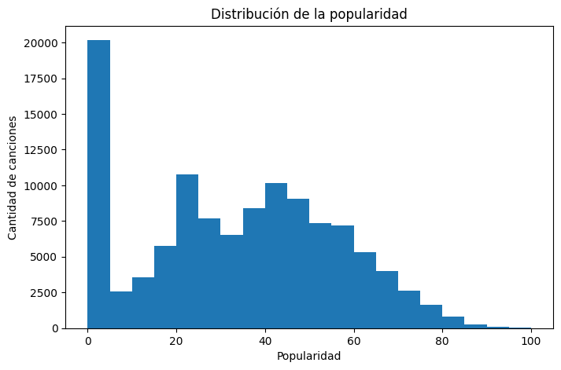
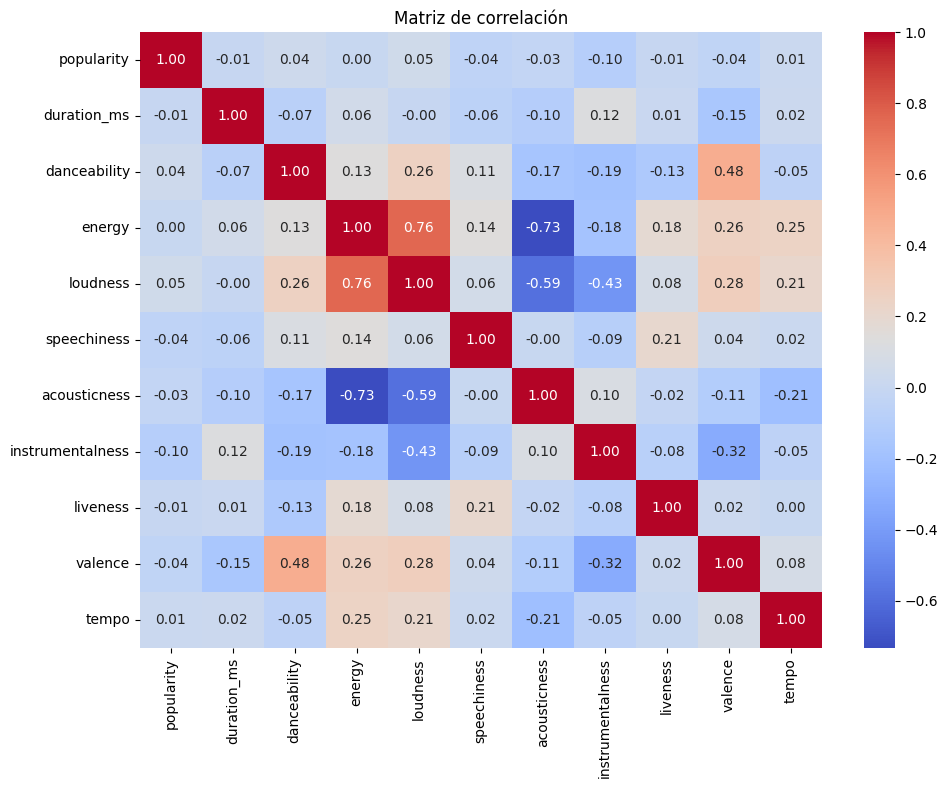
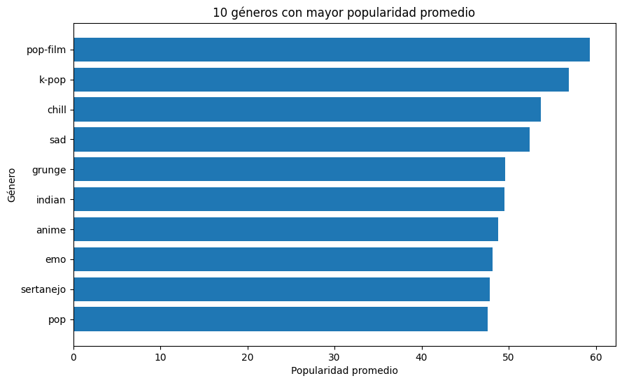

# Informe técnico: Inteligencia musical y predicción de popularidad de canciones

**Asignatura:** Machine Learning (MLY1101) - Evaluación Parcial N°1
**Caso:** C - Spotify Tracks
**Integrantes:** Moira Bittner, Lucas Fernandez y Julian Martinez
**Notebook asociado:** `notebooks/EP1_Spotify_Moira_Lucas_Julian.ipynb`

---

## 1. Descripción del problema de negocio

Planteamos el caso de un **sello discográfico o equipo de marketing musical** que tiene que decidir en qué canciones invertir su presupuesto de promoción. Hoy esa decisión se toma en gran parte por intuición, lo que puede llevar a gastar recursos en canciones con poco potencial.

Queremos saber si es posible **estimar la popularidad de una canción a partir de sus características musicales y descriptivas**. La variable objetivo es `popularity` (de 0 a 100) y, como es numérica, lo abordamos como un problema de **regresión supervisada**.

---

## 2. Objetivos del proyecto

**Objetivo general:** analizar las características musicales y descriptivas de las canciones para identificar patrones y variables útiles en la predicción de su popularidad.

**Objetivos específicos:**

1. Evaluar la calidad del dataset: valores nulos, duplicados, valores atípicos y registros anómalos.
2. Explorar la distribución de `popularity` y su relación con las características musicales, el género y el contenido explícito.
3. Preparar los datos para el modelamiento: limpieza, codificación, división y escalamiento.
4. Identificar posibles sesgos, riesgos éticos y aspectos de privacidad de los datos.

---

## 3. Definición de KPIs

Definimos como **canción de alto potencial** a la que tiene `popularity >= 50`, que corresponde al cuartil superior del dataset.

| Nivel | KPI | Meta |
|---|---|---|
| Negocio | Precisión en el top 10 %: de las canciones con mayor popularidad predicha, % que realmente son de alto potencial | ≥ 60 % |
| Modelo | MAE: error promedio en puntos de popularidad | ≤ 13,79 puntos |
| Modelo | R²: variabilidad de `popularity` explicada por el modelo | ≥ 0,35 |
| Datos | Calidad del dataset preparado | 0 nulos, 0 duplicados y 0 registros de audio inválidos |

Elegimos la precisión en el top 10 % porque el sello no promociona todo el catálogo, sino una selección pequeña. El MAE se expresa en puntos de popularidad, así que es fácil de explicar. Su meta la fijamos como un 20 % menos que el error de predecir siempre la popularidad promedio, que es de 17,24 puntos (17,24 × 0,8 = 13,79). Los KPIs de negocio y de modelo se medirán en la etapa de modelado; el de calidad de datos **ya se cumple** (sección 4.8.2 del notebook).

---

## 4. Descripción de las fuentes de datos

| Aspecto | Detalle |
|---|---|
| Archivo | `Spotify_Tracks_Dataset.csv` |
| Origen | *Spotify Tracks Dataset*, publicado en Kaggle por Maharshi Pandya, con datos obtenidos desde Spotify |
| Tamaño | 114.000 registros y 21 columnas |
| Variable objetivo | `popularity`: calculada por Spotify según la cantidad de reproducciones y qué tan recientes son |

**Variables principales:**

| Tipo | Variables |
|---|---|
| Identificadores y texto | `track_id`, `artists`, `album_name`, `track_name`, `track_genre` |
| Características musicales (0 a 1) | `danceability`, `energy`, `speechiness`, `acousticness`, `instrumentalness`, `liveness`, `valence` |
| Otras numéricas | `duration_ms`, `loudness` (dB), `tempo` (BPM) |
| Categóricas codificadas como números | `key` (tonalidad 0-11), `mode` (mayor/menor), `time_signature` (compás) |
| Booleana | `explicit` |

**Herramientas:** trabajamos en **Google Colab**, porque ejecuta Python desde el navegador sin instalar nada y guarda el notebook en Google Drive, lo que nos permitió compartirlo y trabajar sobre la misma versión. Además, subimos el proyecto a un repositorio de **GitHub**, que guarda el historial de cambios de cada integrante y mantiene la estructura de carpetas para que cualquier persona pueda descargar y ejecutar la solución. Para el análisis usamos **Pandas** y **NumPy** (manipulación de datos), **Matplotlib** y **Seaborn** (gráficos) y **Scikit-learn** (división y escalamiento).

---

## 5. Preparación y análisis exploratorio de los datos (EDA)

### 5.1 Calidad de los datos

| Aspecto | Hallazgo | Acción |
|---|---|---|
| Valores nulos | 1 registro con nulos en `artists`, `album_name` y `track_name` | Eliminado |
| Columna `Unnamed: 0` | Índice sin valor que ocultaba duplicados | Eliminada |
| Filas duplicadas | 450 al quitar `Unnamed: 0` | Eliminadas |
| `track_id` repetidos | 24.259: la misma canción en varios géneros | Una fila por canción para modelar |
| Audio no medible | 163 registros con `tempo = 0` o `time_signature = 0` (la mayoría del género `sleep`) | Eliminados para modelar |
| Popularidad 0 | 16.020 canciones (14,05 %) | Mantenidas como limitación |
| Duración atípica (IQR) | 5.617 registros (4,93 %) | Mantenidos, son canciones válidas |

### 5.2 Principales hallazgos del EDA

- **Popularidad:** tiene una media de 33,24 y una mediana de 35, y la mitad central de las canciones está entre 17 y 50.



En el histograma destaca la barra de valores cercanos a 0, lo que nos llevó a revisar esos casos:

- **Popularidad 0:** el 27,0 % de las canciones repetidas (mismo artista y nombre) tiene popularidad 0, frente al 4,3 % de las que no se repiten. Además, géneros como `iranian`, `romance` y `latin` aparecen entre los menos populares principalmente porque cerca del 60 % de sus canciones tiene popularidad 0.
- **Correlaciones:** todas las características musicales tienen correlaciones bajas con `popularity`; la más alta en valor absoluto es `instrumentalness`, con -0,10. En cambio, `energy` y `loudness` están muy relacionadas entre sí.



- **Género:** es la variable con diferencias más claras. Los géneros con mayor popularidad media son `pop-film` (59,28), `k-pop` (56,90) y `chill` (53,65).



- **Contenido explícito:** las canciones explícitas tienen una popularidad media de 36,45, frente a 32,94 de las no explícitas. Esto no implica causalidad.
- **Balance:** hay exactamente 1.000 canciones por género, lo que indica un muestreo artificial.

**Conclusión del EDA:** ninguna variable explica por sí sola la popularidad, así que el modelo tendrá que combinar varias.

### 5.3 Preparación de los datos

| Paso | Acción | Filas | Justificación |
|---|---|---|---|
| 1 | Eliminar `Unnamed: 0`, nulos y duplicados | 113.549 | Registros sin valor o repetidos |
| 2 | Convertir `explicit` a 0/1 y crear `duration_min` | 113.549 | Formato numérico y unidad más fácil de interpretar |
| 3 | Eliminar audio no medible | 113.386 | Sus características no describen una canción real |
| 4 | Una fila por `track_id`, elegida al azar con semilla 42 | 89.578 | Evitar que una misma canción quede en entrenamiento y en prueba (fuga de información). No usamos la primera aparición porque el archivo está ordenado por género |
| 5 | Excluir identificadores, `artists` y `duration_ms` | 89.578 | No son características musicales o son redundantes |
| 6 | One-hot encoding de `track_genre`, `key` y `time_signature` | 89.578 | Son categorías sin orden; quedan 142 variables |
| 7 | División 80/20 en entrenamiento y prueba | 71.662 / 17.916 | Evaluar el modelo con datos que no vio |
| 8 | `StandardScaler` en las variables continuas, ajustado solo con entrenamiento | - | Escalas muy distintas; se ajusta solo con entrenamiento para evitar fuga de información |

---

## 6. Metodología utilizada (CRISP-DM)

Usamos **CRISP-DM** porque parte desde el problema de negocio y permite volver a etapas anteriores cuando aparecen problemas en los datos.

| Fase | Qué hicimos | Estado |
|---|---|---|
| 1. Comprensión del negocio | Problema, objetivos y KPIs | Desarrollada |
| 2. Comprensión de los datos | Calidad, anomalías y EDA | Desarrollada |
| 3. Preparación de los datos | Limpieza, codificación, división y escalamiento | Desarrollada |
| 4. Modelado | Entrenar modelos de regresión | Próxima etapa |
| 5. Evaluación | Medir los KPIs | Próxima etapa |
| 6. Despliegue | Uso de las predicciones por el negocio | Próxima etapa |

---

## 7. Evaluación de sesgos, ética y privacidad

- **Sesgo de muestreo:** con 1.000 canciones por género, el dataset no representa el catálogo real de Spotify.
- **Sesgo en la variable objetivo:** `popularity` depende de la promoción, las tendencias y la exposición del artista, no de la calidad de la canción. Además, el 14,05 % de ceros se concentra en ciertos géneros.
- **Riesgo ético:** si el sello solo promociona lo que el modelo predice como popular, los artistas emergentes y los géneros minoritarios tendrán menos oportunidades. El modelo debe ser un apoyo a la decisión, no una decisión automática.
- **Privacidad:** no hay datos de usuarios, pero `artists` contiene nombres de personas, así que no la usamos en el modelo. Esto va en línea con la **Ley 21.719**, que exige usar solo los datos necesarios.
- **Uso de la fuente:** los términos para desarrolladores de Spotify prohíben usar su contenido para entrenar modelos de machine learning, por lo que el proyecto es solo con fines académicos.

---

## 8. Conclusiones

El dataset tiene suficientes registros y pocos nulos, pero presenta problemas de calidad que solo aparecieron al revisarlo en detalle: duplicados ocultos, audio no medible y un 14,05 % de popularidad 0. Ninguna característica musical explica por sí sola la popularidad; el género es la variable con diferencias más claras.

Dejamos un dataset de **89.578 canciones únicas** y **142 variables**, sin nulos ni duplicados, codificado, dividido y escalado. En la siguiente etapa entrenaremos modelos de regresión y los evaluaremos con los KPIs definidos.

---

## 9. Reproducibilidad

### Estructura del proyecto

```
spotify-popularidad-ml/
├── README.md
├── Informe_Tecnico_EP1_Spotify.md
├── requirements.txt
├── data/
│   ├── raw/
│   │   └── Spotify_Tracks_Dataset.csv          # dataset original
│   └── processed/
│       └── Spotify_Tracks_Dataset_Limpio.csv   # generado por el notebook
├── notebooks/
│   └── EP1_Spotify_Moira_Lucas_Julian.ipynb
├── images/                                     # gráficos del informe, generados por el notebook
└── models/                                     # reservada para los modelos de la próxima etapa
```

### Cómo ejecutar

1. Instalar las librerías con `pip install -r requirements.txt` (en Google Colab ya vienen instaladas).
2. Abrir `notebooks/EP1_Spotify_Moira_Lucas_Julian.ipynb`.
3. Ejecutar todas las celdas en orden. El notebook lee los datos desde `data/raw/`, guarda el dataset limpio en `data/processed/` y los gráficos en `images/`. Como usa la semilla 42, siempre entrega los mismos resultados.

Las instrucciones para ejecutarlo en Google Colab están en el `README.md`.

**Referencias:** Pandya, M. *Spotify Tracks Dataset*, Kaggle (https://www.kaggle.com/datasets/maharshipandya/-spotify-tracks-dataset) · Spotify Developer Terms (https://developer.spotify.com/terms) · Ley N° 21.719, Diario Oficial de Chile, 2024.
